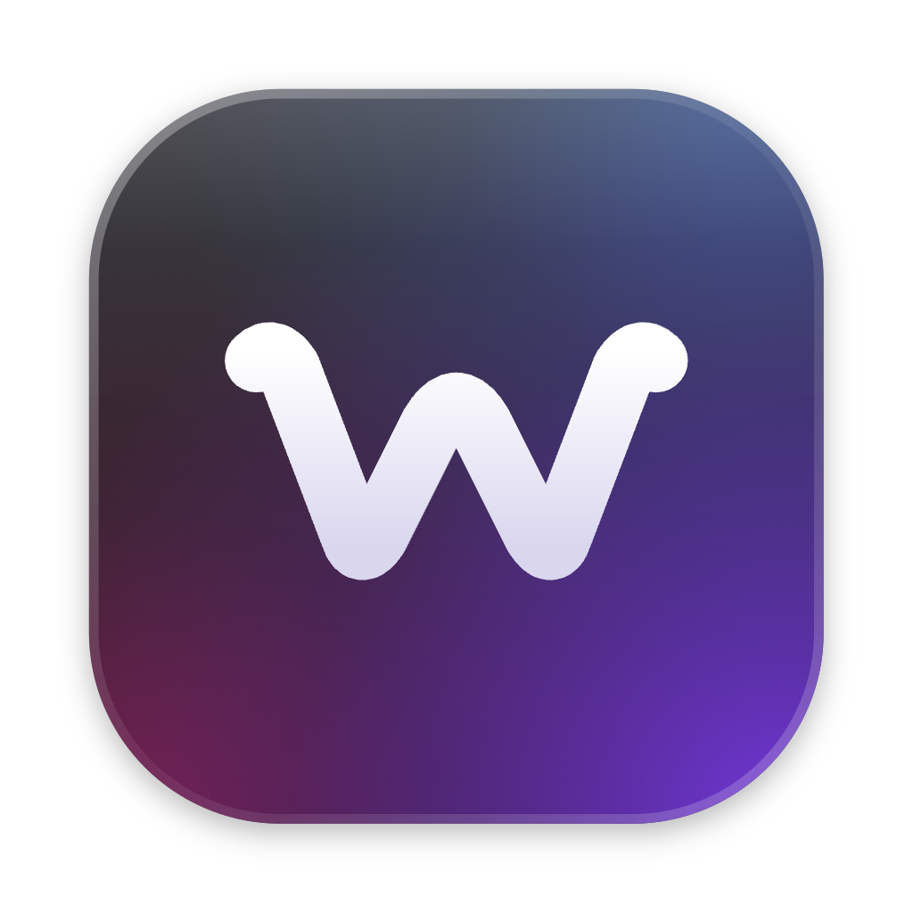
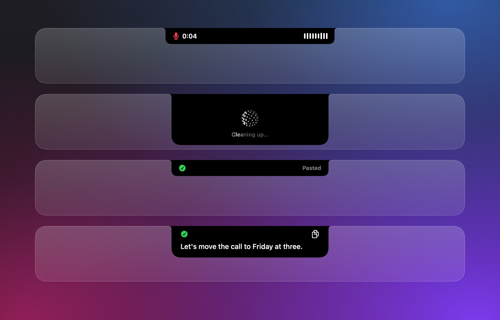
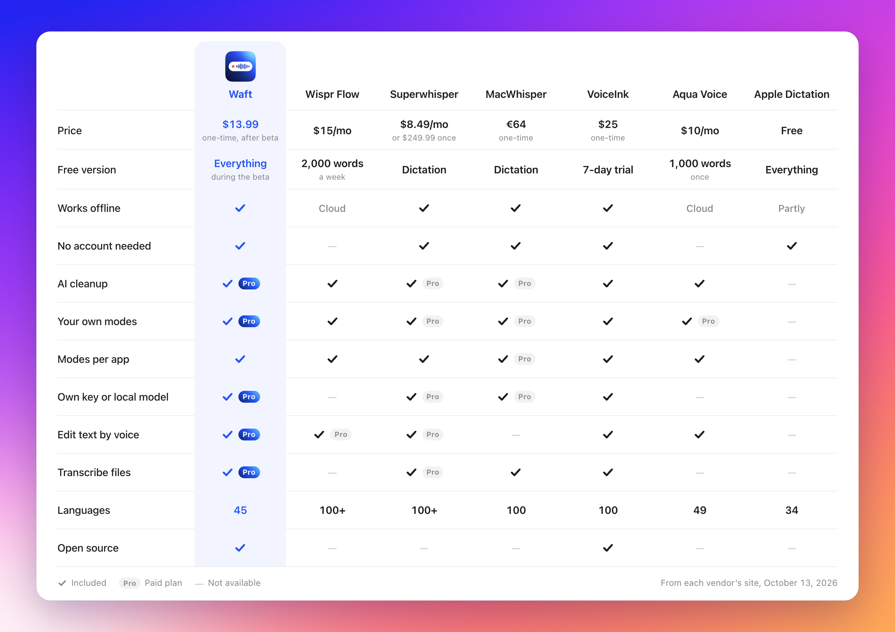

  

<h1 align="center">Waft</h1>

On-device dictation for macOS with AI cleanup.

  
  
  

  <a href="https://waft.okoflow.com">Website</a> ·
  <a href="#install">Install</a> ·
  <a href="docs/getting-started.md">Getting started</a> ·
  <a href="docs/usage.md">Usage</a> ·
  <a href="docs/privacy.md">Privacy</a>

https://github.com/user-attachments/assets/a6d44cd4-8c34-40dc-84f6-095fab844ae6

**Hold <kbd>right ⌥</kbd>, speak, let go.** The text appears wherever you are
typing, in any app. Speech is recognized on your Mac; an AI mode cleans it up
when you want prose rather than a transcript.

<table>
  <thead>
    <tr>
      <td
        width="33%"
        valign="top"
      ><b>Private</b> Whisper runs on your Mac through WhisperKit. Audio is
        never saved or sent.</td>
      <td
        width="33%"
        valign="top"
      ><b>45 languages</b> Waft detects which of your languages you speak,
        and translates between them.</td>
      <td
        width="33%"
        valign="top"
      ><b>AI cleanup</b> Clean, Formal, Translate, or your modes, with
        Claude, OpenAI, or a local server.</td>
    </tr>
  </thead>
  <tbody>
    <tr>
      <td valign="top"><b>Edit by voice</b> Select text, hold a key, and say
        "make it shorter".</td>
      <td valign="top"><b>Transcribe files</b> Recordings and videos to text
        or SRT subtitles.</td>
      <td valign="top"><b>Your words</b> A dictionary for names, snippets for
        phrases, history on your Mac.</td>
    </tr>
  </tbody>
</table>

## How it compares

<picture>
  <source
    media="(prefers-color-scheme: dark)"
    srcset=".github/screenshots/comparison-dark.jpg"
  >
  
</picture>

## Install

Waft runs on a Mac with Apple silicon and macOS 14 or later.
[Getting started](docs/getting-started.md) walks you from building it to your
first dictation.

## Documentation

| Guide | What it covers |
| --- | --- |
| [Getting started](docs/getting-started.md) | Installing, the permissions, and your first dictation |
| [Usage](docs/usage.md) | Modes, languages, editing by voice, files, the dictionary, history, and every setting |
| [How it works](docs/how-it-works.md) | What happens between the key and the pasted text |
| [Privacy](docs/privacy.md) | What stays on your Mac, what leaves it, and how to remove everything |
| [Troubleshooting](docs/troubleshooting.md) | What to do when something doesn't work, and what the menu and the HUD tell you |
| [Architecture](docs/architecture.md) | How the code is organized, for contributors |

## Waft Pro

Waft Pro adds the AI modes, editing by voice, file transcription, and the
Accurate speech model for a single payment of $13.99. **Free while Waft is in
beta.** [Waft Pro](docs/usage.md#waft-pro) covers the details.

## Contributing

Pull requests are welcome. [CONTRIBUTING.md](CONTRIBUTING.md) covers the
setup, the checks CI runs, and the conventions. Report vulnerabilities
privately as described in [SECURITY.md](SECURITY.md).

## License

Waft is copyright The Waft Authors, listed in [AUTHORS](AUTHORS), and licensed
under GPL-3.0-only, whose text is in [LICENSE](LICENSE). Releases up to 0.3.0
were MIT; [NOTICE](NOTICE) keeps those terms. The license covers the code, not
the Waft name and logo.
