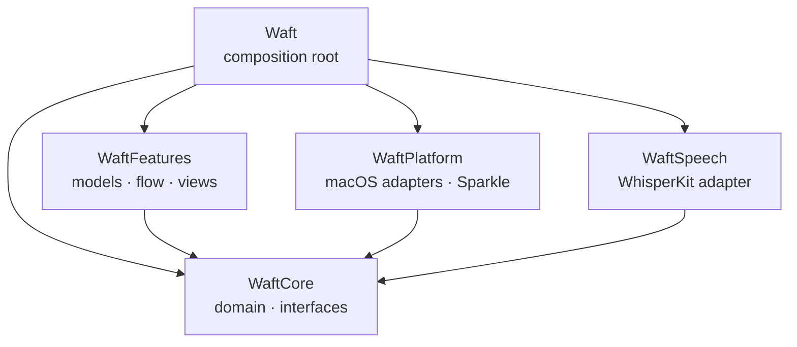

# Architecture

This page maps the code for contributors: where things live, the path a dictation takes through them, and the rules that keep them in place. [How it works](how-it-works.md) describes the same flow from the user's side, and [CONTRIBUTING.md](../CONTRIBUTING.md) how the code reads and is checked.

## Modules

| Module | Isolation | What lives there |
| --- | --- | --- |
| `WaftCore` | Nonisolated | Domain types, text and recognition rules, state machines, and every interface between modules |
| `WaftSpeech` | Nonisolated | `WhisperTranscriber`, its decoding rules, the model files, and the language-restricted tokenizer |
| `WaftPlatform` | Nonisolated | Adapters for audio, the keyboard, Accessibility, the pasteboard, storage, the AI APIs, license signatures, updates, and the system |
| `WaftFeatures` | Main actor | Observable models, the dictation flow, and every window and view |
| `Waft` | Main actor | The app, its delegate, and `AppDependencies.live()` |

## Code map

The tables list the folders whose names don't say enough.

**`WaftCore`** is grouped by domain:

| Folder | What lives there |
| --- | --- |
| `Keyboard` | Key events and the `KeyEventMonitor` interface. `PushToTalk` holds the state machine from key events to start, hands-free, finish, and discard; `RecordingTriggers`, which runs one for the dictation key and one for the editing key; and `ReleaseWatchdog`, which catches a lost key-up. `Shortcuts` holds the global shortcuts and their defaults |
| `Speech` | `Model` holds `SpeechModelState`, whose transitions return the effects a controller runs. `Recognition` holds the `Transcriber` interface, `SpeechGate`, `WhisperPrompt`, and `HallucinationFilter`. `Files` holds file transcription and subtitles |
| `Text` | String rules that several features share, and Light mode in `LightMode` |
| `Settings` | `Settings` and its extensions, which list the modes, turn a mode or a `TextTask` into a `RewriteSetup`, and find the shortcut a new combination conflicts with |
| `Rewrite` | `TranscriptProcessor`, which runs the dictionary, the mode, and the AI model under a deadline. `Providers` holds the providers and the `TextRewriter` interface, and `Prompt` holds `RewritePrompt` and `RewriteValidator` |
| `Translator` | `TextTask`, the work the translator does on typed text, and `TranslatorSettings` |
| `Insertion` | The `TextInserter` interface, and whether and how to paste: focus comparison, spacing, and restoring the clipboard |
| `Storage` | The `ValueStore` interface and the lenient decoding that keeps one bad field from resetting the rest |
| `Usage` | What is counted, the days that wait to be sent with the installation's random ID, the `UsageReport` the usage service accepts, and the `UsageReportSender` interface |
| `Support` | Helpers that every module uses, such as `Poll`, `Task.slept`, and `Error.logDescription` |

**`WaftPlatform`** implements the interfaces in a folder per area, such as `KeyEventTap` in `Keyboard`, `AudioEngineRecorder` in `Audio`, and `PasteboardInserter` in `Pasteboard`.

- `Rewrite` holds `HTTPRewriter`, which sends a rewrite through the API description of each service in `Providers`, and `LocalServerBrowser`, which lists a local server's models.
- `Storage` holds `JSONFileStore`, which keeps its folder and files owner-only and a copy of a file it can't read, and `SecretFileStore`, which keeps an API key or the license key in such a file and moves one an older version left in the keychain into it.
- `Usage` holds `HTTPUsageReportSender`, which posts a `UsageReport` to the usage service of `okoflow/waft-server`.
- `Updates` holds `SparkleUpdater`, which turns itself off when `Info.plist` has no `SUFeedURL`. `scripts/bundle.sh` removes the key from debug bundles.

**`WaftFeatures`** is grouped by feature:

| Folder | What lives there |
| --- | --- |
| `App` | `AppDependencies`; `AppModel`, which builds every model from them and wires the models together; and `WindowPresenter`, which opens the windows and shows the Dock icon while one needs it |
| `Models` | The observable state that several features share; a model that one screen uses lives with that screen. `UsageReporter` counts and sends only while `Settings.usageSharing` is `.allowed` and the build has a version |
| `Dictation` | The controllers of [the dictation flow](#the-dictation-flow) and the values they pass along. `TextDelivery` pastes a text or copies it when it can't paste, for a dictation and for the translator's shortcuts |
| `Keyboard` | `KeyMonitorController`, which starts the `KeyEventMonitor` and restarts it when it stops; `GlobalShortcutController`, which registers the global shortcuts; and `KeyRecorder` and `ShortcutRecorder`, which capture a new key or shortcut in Settings |
| `HUD` | `HUDController` and `HUDPanel`, which floats below the menu bar when `ForeignWindow` finds another app's window over the notch; `Island` holds the views inside it |
| `Settings` | `Window` holds the Settings window, its sidebar, and `SettingsPage`, the page every pane sits in; a folder per pane holds that pane; and `Shared` holds what several panes or the setup guide use |
| `Translator` | `Panel` holds `TranslatorModel` and the floating panel, which opens over the app in front without activating Waft. `Selection` holds `SelectionActions`, which reads the selected text through Accessibility, or copies it through the `TextInserter`, and translates or fixes it |
| `DesignSystem` | `Tokens` (colors, metrics, motion, and fonts), `Brand`, `Controls`, `Rows` (the cards, sections, and rows of Settings and the setup guide), and view `Modifiers` |

**`Tests`** has a Swift Testing target for every module but `Waft`, laid out as [Tests](../CONTRIBUTING.md#tests) describes. **`Packaging`** holds the rest of the app bundle and the Homebrew cask template, and **`scripts`** the shell scripts that `make` runs.

## The dictation flow

1. `PermissionMonitor` polls the microphone and Accessibility status. A change moves onboarding on and makes `KeyMonitorController` start the `KeyEventMonitor`, which it also restarts when the monitor stops.
2. `DictationController` feeds the monitor's key events to `RecordingTriggers` and hands finished recordings to the queue. `RecordingController` starts and stops the `AudioRecorder`, polls `ReleaseWatchdog` for a lost key-up, and captures the focus target. When the recording of a dictation fails after it captured audio, the controller hands that audio to the queue too.
3. `DictationQueue` runs finished recordings one at a time: the `Transcriber` recognizes them, `TranscriptProcessor` applies the dictionary, snippets, and the mode, and the `TextInserter` pastes the result.
4. An AI mode runs the `TextRewriter` under the deadline of the chosen `CloudModel` or the local server, validates the answer with `RewriteValidator`, and on any `RewriteError` falls back to Light with a `RewriteFallback` that says why.
5. An edit by voice gives Whisper the dictionary terms but skips their replacements, the snippets, and the mode: `TranscriptProcessor.edit` sends the selection read at the key press and the spoken instruction to the `TextRewriter`, and the answer replaces the selection. A failure pastes nothing.
6. The outcome becomes a `HUDMessage`. The text becomes the latest transcript and is either pasted or copied, so none is dropped: a password field gets a copy instead of a paste. Text that is pasted or copied becomes a history entry unless it came from an edit or was kept out of a password field.

## Invariants

- Dependencies point toward `WaftCore`, which imports Foundation only and builds with strict memory safety. `WaftFeatures` never imports an adapter module; it sees adapters through the interfaces in `WaftCore`.
- Only `AppDependencies.live()` names concrete adapters. There are no singletons.
- Declarations shared between modules are `package`, never `public`. Imports follow the `InternalImportsByDefault` rule in [Platform](../CONTRIBUTING.md#platform).
- Rules that need no system access are value types in `WaftCore`.
- `WhisperTranscriber`, `AudioEngineRecorder`, and `MediaAudioReader` are actors, so recognition, audio, and media files stay off the main actor. The last two run on serial dispatch queues of their own, so their blocking calls never hold a thread of the cooperative pool.
- Audio, dictated text, and clipboard contents never reach the log or the disk, apart from the history the user keeps.
- A `UsageReport` holds counts, versions, and the names of settings, never text, audio, or the name of an app or a file, and nothing is counted or sent before the user agrees. A new field goes into [Usage data](privacy.md#usage-data) and `parseUsageReport` in `okoflow/waft-server` in the same release.
- User-facing strings use `String(localized:)` or `LocalizedStringKey`, even the names of domain values in `WaftCore`. Choosing a language in Waft writes `AppleTextDirection` next to `AppleLanguages`, so Arabic and Hebrew lay out right to left.

## Third-party packages

The package depends only on WhisperKit, from `argmax-oss-swift`, and Sparkle, pinned to exact versions in `Package.swift`. A pull request that adds a dependency says why the package needs it.

## Extending

To add a language:

1. Add a case to `Language` with its Whisper code.
2. Add its names in `Language+Names` and its writing systems in `Language+Typography`, where a period or question mark of its own also goes. Letter case and word spacing follow from the `WritingScript`.
3. If it has marks that comparisons ignore, list them in `Language+Folding`.
4. Add its rows: hesitation sounds in `HesitationPattern`, stock phrases in `StockPhrase`, voice commands in `VoiceCommands`, and the example sentence in `WhisperPrompt`.
5. If it sounds like another language, add a group in `Language+SoundAlike`.

To add anything else:

- **A mode.** Add a case to `Mode` with its title, summary, and the raw value it is stored under, and list it in `Mode.builtIn`. An AI mode needs its instruction in `RewritePrompt`.
- **An AI provider.** Describe its API in `WaftPlatform/Rewrite/Providers` as a `RewriteAPI` with a model identifier for each `CloudModel`, add a `CloudProvider` case, a `PerProvider` property, the names of its models in `CloudProvider+Display`, and its key file in `SecretFileStore.apiKey(for:)`, wire it in `Rewriters.http`, and list its file in [What Waft keeps](privacy.md#what-waft-keeps).
- **An adapter.** Implement the interface in `WaftPlatform` and pass it in `AppDependencies.live()`.
