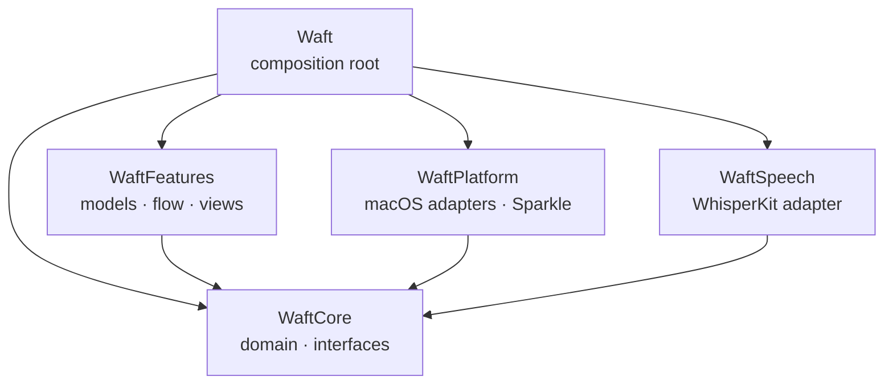
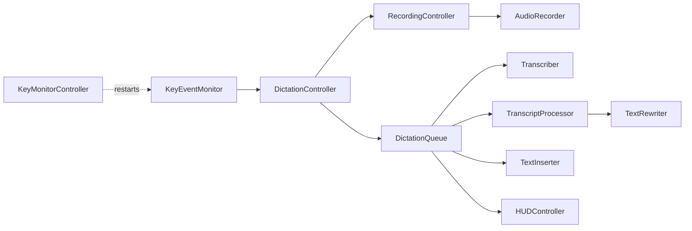

# Architecture

This page maps the code for contributors: where things live, the paths a
dictation takes through them, and the rules that keep them in place.
[How it works](how-it-works.md) describes the same flow from the user's side,
and [CONTRIBUTING.md](../CONTRIBUTING.md) how the code reads and is checked.

## The problem

Waft listens to a global key, records the microphone, recognizes the speech on
the Mac, optionally rewrites the text with an AI model, and pastes it into
whatever app has focus. Most of that touches system APIs that can't run in a
test: the event tap, the audio engine, Accessibility, the pasteboard. The
design keeps those at the edges, behind small interfaces, so the rules in
between are plain values that can be reasoned about and tested on their own.

## Modules

| Module | Isolation | What lives there |
| --- | --- | --- |
| `WaftCore` | Nonisolated | Domain types, text and recognition rules, state machines, and every interface between modules |
| `WaftSpeech` | Nonisolated | `WhisperTranscriber`, the model files, and the language-restricted tokenizer |
| `WaftPlatform` | Nonisolated | Adapters for audio, media files, the keyboard, Accessibility, the pasteboard, storage, the AI APIs, license signatures, updates, and the system |
| `WaftFeatures` | Main actor | Observable models, the dictation flow, the HUD, the menu, Settings, onboarding, and file transcription |
| `Waft` | Main actor | The app, its delegate, and `AppDependencies.live()` |

## Code map

**`WaftCore`** is grouped by domain:

| Folder | What lives there |
| --- | --- |
| `Keyboard` | The `KeyEventMonitor` interface; `PushToTalk`, the state machine that turns key events into start, hands-free, finish, and discard for the chosen `DictationStart`; `RecordingTriggers`, which runs one for the dictation key and one for the editing key; `ReleaseWatchdog`, which catches a lost key-up |
| `Recording` | The `AudioRecorder` interface, input devices, and audio levels |
| `Speech` | The `Transcriber` interface, `SpeechModelState`, whose transitions return the effects a controller runs, `SpeechGate`, `WhisperPrompt`, and `SubtitleFormatter` |
| `Language` | `Language` with its names, writing systems, the languages that sound alike, and the `WritingVariants` a user chooses for Chinese and Serbian |
| `Text` | Light mode (`LightModeRules`, `VoiceCommands`), `HallucinationFilter`, and `SerbianCyrillic` |
| `Vocabulary` | The dictionary and snippets |
| `Mode` | The built-in modes, the `CustomMode`s a user writes, and the modes for each app |
| `Settings` | `Settings`, and `Settings+Modes`, which lists every mode and turns one into a `RewriteSetup` |
| `Rewrite` | `TranscriptProcessor`, which runs the dictionary, the mode, and the AI model under a deadline; the providers and `CloudModel`; `RewritePrompt`; `RewriteValidator` |
| `Insertion` | Whether and how to paste |
| `History` | The history, the statistics, and the recent transcripts |
| `License` | License keys and access to Waft+ |
| `Storage` | The `ValueStore` interface and, in `KeyedDecodingContainer+Defaults`, the lenient decoding that keeps one bad field from resetting the rest |
| `System` | Interfaces to permissions, updates, sounds, the login item, and running apps |

**`WaftPlatform`** implements the interfaces in a folder per area, such as
`KeyEventTap` in `Keyboard`, `AudioEngineRecorder` in `Audio`, and
`PasteboardInserter` in `Pasteboard`. `Network` holds `HTTPRewriter`, which
sends a rewrite through an API description per service (`AnthropicAPI`,
`OpenAIAPI`, and `ChatCompletionsAPI` for local servers), and
`LocalServerBrowser`, which lists a local server's models.

**`WaftFeatures`** is grouped by feature:

| Folder | What lives there |
| --- | --- |
| `App` | `AppDependencies`; `AppModel`, which builds every model from them and wires the models together; `WindowPresenter` |
| `Models` | The app-wide observable state |
| `Dictation` | The controllers of [the dictation flow](#the-dictation-flow) |
| `HUD` | `HUDController` and the HUD window |
| `MenuBar` | The menu bar icon and the menu |
| `Onboarding` | The setup guide |
| `Settings` | The Settings window and a folder per pane |
| `Transcription` | File transcription |
| `DesignSystem` | The visual building blocks |
| `Support` | Helpers without a view |

**`Tests`** has a Swift Testing target for every module but `Waft`;
[Tests](../CONTRIBUTING.md#tests) says how they are written.

**`Packaging`** holds what the app bundle is made of besides the code:
`Waft-Info.plist`, the entitlements, the icon, and the translations, plus the
template of the Homebrew cask. **`scripts`** holds the shell scripts that
`make` runs to bundle the app, create the signing identity, release, and check
and update the translations.

## The dictation flow

1. `KeyMonitorController` keeps the `KeyEventMonitor` running, restarting it
   when a permission arrives or macOS switches it off.
2. `DictationController` reads the monitor's key events, feeds them to
   `RecordingTriggers`, and hands finished recordings to the queue.
   `RecordingController` starts and stops the `AudioRecorder`, polls
   `ReleaseWatchdog` in case a key-up is lost, and captures the focus target.
3. `DictationQueue` runs finished recordings one at a time: the `Transcriber`
   recognizes them, `TranscriptProcessor` applies the dictionary, snippets,
   and the mode, and the `TextInserter` pastes the result.
4. An AI mode runs the `TextRewriter` under the deadline of the chosen
   `CloudModel` or the local server, checks the answer with
   `RewriteValidator`, and on any `RewriteError` falls back to Light with a
   `RewriteFallback` that says why.
5. An edit by voice skips the dictionary, snippets, and mode:
   `TranscriptProcessor.edit` sends the selection that `RecordingController`
   read at the key press, with the spoken instruction, to the `TextRewriter`,
   and the answer replaces the selection. A failure pastes nothing.
6. The outcome becomes a `HUDMessage`. Text that is pasted or copied becomes
   the latest transcript and, unless it came from an edit, a history entry.

## Invariants

- Dependencies point toward `WaftCore`. `WaftCore` imports Foundation only
  and builds with strict memory safety, so unsafe code fails the build unless
  it is marked `unsafe`, and none is. `WaftFeatures` never imports an adapter
  module; it sees adapters through the interfaces in `WaftCore`.
- Only `AppDependencies.live()` names concrete adapters. There are no
  singletons.
- Declarations shared between modules are `package`, never `public`. With
  `InternalImportsByDefault`, an import is `package import` only when a
  package declaration's signature names the module's types. A type reached
  through an alias, such as `CustomMode.ID` for `UUID`, doesn't count.
- Rules that need no system access are value types in `WaftCore`.
- Audio, dictated text, and clipboard contents never reach the log or the
  disk, apart from the history the user keeps.
- The package builds with the Command Line Tools alone, as
  [Platform](../CONTRIBUTING.md#platform) describes.

## Third-party packages

The package depends only on WhisperKit and Sparkle. The usual candidates don't
earn their cost:

| Package | Why not |
| --- | --- |
| KeyboardShortcuts | No modifier-only or Fn push-to-talk, and a resource bundle the app would have to copy |
| LaunchAtLogin | Only wraps what `MainAppLoginItem` does |
| Defaults | Would replace `ValueStore` and the lenient decoding in `KeyedDecodingContainer+Defaults` |
| swift-dependencies | Brings macros and swift-syntax for what `AppDependencies` already does |
| swift-log | Loses the privacy redaction of `os.Logger` |

## Cross-cutting concerns

- **Concurrency.** The package uses the Swift 6 language mode with complete
  checking, `NonisolatedNonsendingByDefault`, and every warning as an error.
  `WhisperTranscriber` and `AudioEngineRecorder` are actors, so recognition
  and audio stay off the main actor.
- **Errors.** [Control flow](../CONTRIBUTING.md#control-flow) covers error
  enums and typed throws. `ValueStore+Logging` in `WaftFeatures/Support` logs
  persistence failures, and `JSONFileStore` keeps a copy of a file it can't
  read, so a later save doesn't destroy it.
- **Localization.** User-facing strings use `String(localized:)` or
  `LocalizedStringKey`, including the names of domain values in `WaftCore`,
  so every surface says the same thing. Choosing a language in Waft writes
  `AppleTextDirection` next to `AppleLanguages`, so Arabic and Hebrew lay out
  right to left; `contentDirection(of:)` aligns dictated text by its own
  script.
- **Permissions.** `PermissionMonitor` polls the microphone and Accessibility
  status once a second; a change restarts the key monitor and moves
  onboarding on.
- **Updates.** `SparkleUpdater` turns itself off when `Info.plist` has no
  `SUFeedURL`, which `scripts/bundle.sh` removes from debug bundles, so they
  never update themselves. While Sparkle shows an update, `WindowPresenter`
  gives Waft a Dock icon so the window can't get lost behind others.

## Extending

- **A language.** Add a case to `Language` with its Whisper code, its names in
  `Language+Names`, and its writing systems in `Language+Typography`, where a
  period or question mark of its own also goes. Letter case and word
  spacing follow from the `WritingScript`, and marks that comparisons ignore
  go in `Language+Folding`. Then add its rows: hesitation sounds in
  `HesitationPattern`, stock phrases in `StockPhrase`, voice commands in
  `VoiceCommands`, the example sentence in `WhisperPrompt`, and a group in
  `Language+SoundAlike` if it sounds like another language.
- **A mode.** Add a case to `Mode` with its title, summary, and storage key,
  and list it in `Mode.builtIn`. An AI mode needs its instruction in
  `RewritePrompt`.
- **An AI provider.** Describe its API in `WaftPlatform/Network` as a
  `RewriteAPI` with a model identifier for each `CloudModel`, add a
  `CloudProvider` case, a `PerProvider` property, and the names of its models
  in `CloudProvider+Display`, and wire it in `Rewriters.http`.
- **An adapter.** Implement the interface in `WaftPlatform` and pass it in
  `AppDependencies.live()`.
