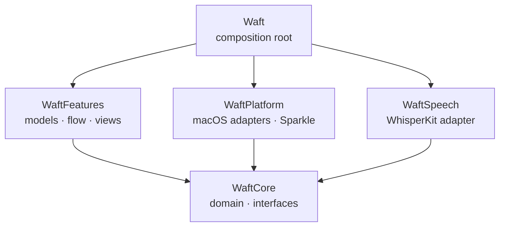
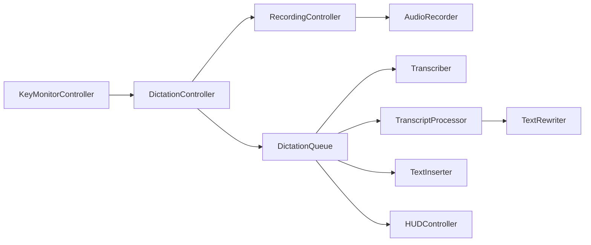

# Architecture

A map of the code for contributors: where things live, the rules that keep
them there, and the paths a dictation takes through them. [How it
works](how-it-works.md) describes the same flow from the user's side.

## The problem

Waft listens to a global key, records the microphone while it's held,
recognizes the speech on the Mac, optionally rewrites the text with an AI
model, and pastes it into whatever app has focus. Most of that touches system
APIs that can't run in a test: the event tap, the audio engine, Accessibility,
the pasteboard. The design keeps those at the edges, behind small interfaces,
so the rules in between are plain values that can be reasoned about and tested
on their own.

## Modules

| Module | Isolation | What lives there |
| --- | --- | --- |
| `WaftCore` | Nonisolated | Domain types, text and recognition rules, state machines, and every interface |
| `WaftSpeech` | Nonisolated | `WhisperTranscriber`, the model files, and the language-restricted tokenizer |
| `WaftPlatform` | Nonisolated | Adapters for audio, the keyboard, Accessibility, the pasteboard, storage, the AI APIs, updates, and the system |
| `WaftFeatures` | Main actor | Observable models, the dictation flow, the HUD, the menu, Settings, onboarding, and file transcription |
| `Waft` | Main actor | The app, its delegate, and `AppDependencies.live()` |

## Code map

**`WaftCore`** is grouped by domain. `Keyboard` holds `PushToTalk`, the state
machine that turns key events into start, finish, and discard for the chosen
`DictationStart`,
`RecordingTriggers`, which runs one for the dictation key and one for the
editing key, and `ReleaseWatchdog`. `Speech` holds `SpeechModelState`, whose
transitions return the effects a controller runs, `SpeechGate`, and
`SubtitleFormatter`. `Text` holds Light mode (`LightModeRules`,
`VoiceCommands`) and `HallucinationFilter`.
`Mode` holds the built-in modes, the `CustomMode`s a user writes, and the
modes for each app; `Settings+Modes` lists them all and turns any mode into a
`RewriteSetup`.
`Rewrite` holds `TranscriptProcessor`, which runs the dictionary, the mode,
and the AI model under a deadline, `RewritePrompt`, and `RewriteValidator`.
`Insertion` decides whether and how to paste. `Storage` holds `ValueStore` and
the lenient decoding that keeps one bad field from resetting the rest.

**`WaftPlatform`** implements the interfaces: `KeyEventTap` (a listen-only
event tap), `AudioEngineRecorder` (an actor on AVAudioEngine),
`PasteboardInserter`, `AccessibilityFocusTracker`, `KeychainStore`,
`JSONFileStore`, `SparkleUpdater`, and the rest. `Network` holds one
`HTTPRewriter` and an API description per service: `AnthropicAPI`,
`OpenAIAPI`, and `ChatCompletionsAPI` for local servers.

**`WaftFeatures`** is grouped by feature. `App` holds `AppModel`, which builds
every model from `AppDependencies` and wires them together, and
`WindowPresenter`. `Models` holds the app-wide observable state. `Dictation`
holds `DictationController`, which feeds key events to `RecordingTriggers`,
`RecordingController`, which runs the recorder for one recording at a time,
and `DictationQueue`, which recognizes, processes, and pastes one recording at
a time. `Settings` has a folder per pane. `DesignSystem` holds the visual
building blocks; `Support` holds helpers without a view.

**`Waft`** is the composition root and holds nothing else: the `App`, its
delegate, and `AppDependencies.live()`, the only place that names concrete
adapters.

**`Tests`** has a Swift Testing target for `WaftCore`, `WaftSpeech`,
`WaftPlatform`, and `WaftFeatures`. The speech tests cover the model files in
a temporary folder, and the feature tests build the main-actor models with
fakes of the `WaftCore` interfaces, so they run without the system.

**`Packaging`** holds what the app bundle is made of besides the code:
`Waft-Info.plist`, the entitlements, the icon, and the translations, plus the
template of the Homebrew cask. **`scripts`** holds the shell scripts that
`make` runs to bundle, sign, release, and check the translations.

## The dictation flow

1. `KeyMonitorController` keeps the `KeyEventMonitor` running, restarting it
   when a permission arrives or macOS switches it off.
2. `DictationController` feeds key events to `RecordingTriggers` and hands
   finished recordings to the queue. `RecordingController` starts and stops the
   `AudioRecorder`, polls `ReleaseWatchdog` in case a key-up is lost, and
   captures the focus target.
3. `DictationQueue` runs finished recordings one at a time: the `Transcriber`
   recognizes them, `TranscriptProcessor` applies the dictionary, snippets,
   and the mode, and the `TextInserter` pastes the result.
4. An AI mode runs the `TextRewriter` under the provider's deadline, checks the
   answer with `RewriteValidator`, and on any `RewriteError` falls back to
   Light with a `RewriteFallback` that says why.
5. The outcome becomes a `HUDMessage`, a history entry, and the latest
   transcript.

## Invariants

- Dependencies point toward `WaftCore`, and `WaftCore` imports Foundation
  only and builds with strict memory safety, so it holds no unsafe code.
  `WaftFeatures` never imports an adapter module; it sees adapters through the
  interfaces in `WaftCore`.
- Only `AppDependencies.live()` names concrete adapters. There are no
  singletons.
- Declarations shared between modules are `package`, never `public`. With
  `InternalImportsByDefault`, an import is `package import` only when a
  package declaration's signature uses the module's types.
- Rules that need no system access are value types in `WaftCore`.
- Audio, dictated text, and clipboard contents never reach the log or the
  disk, apart from the history the user keeps.
- The package builds with the Command Line Tools alone: no Xcode-only SwiftUI
  macros such as `@State`, `@Entry`, or `#Preview`.
- The package depends only on WhisperKit and Sparkle. The usual candidates
  don't earn their cost: KeyboardShortcuts has no modifier-only or Fn
  push-to-talk and ships a resource bundle the app would have to copy,
  LaunchAtLogin only wraps what `MainAppLoginItem` does, Defaults would replace
  the lenient decoding in `ValueStore`, swift-dependencies would bring macros
  and swift-syntax for what `AppDependencies` already does, and swift-log
  would lose the privacy redaction of `os.Logger`.

## Cross-cutting concerns

**Concurrency.** The package uses the Swift 6 language mode with complete
checking, `NonisolatedNonsendingByDefault`, and every warning as an error.
`WaftFeatures` and `Waft` isolate to the main actor by default;
`WhisperTranscriber` and `AudioEngineRecorder` are actors, so recognition and
audio stay off the main actor.

**Errors.** An area with a closed set of failures has its own error enum, such
as `RewriteError`, and uses typed throws where every caller handles every
case. Persistence failures are logged through `ValueStore`'s logging helpers
in `WaftFeatures/Support`, and a JSON file that can't be read is copied aside
before it would be overwritten.

**Localization.** User-facing strings use `String(localized:)` or
`LocalizedStringKey`, including the names of domain values in `WaftCore`, so
every surface says the same thing. `make strings` checks every table in
`Packaging/Localizations` against the strings in the code.

**Permissions.** `PermissionMonitor` polls the microphone and Accessibility
status once a second; a change restarts the key monitor and moves onboarding
on.

**Updates.** Sparkle reads `SUFeedURL` and `SUPublicEDKey` from
`Info.plist`, which also requires a signed feed. `SparkleUpdater` turns
itself off when `SUFeedURL` is missing, which `scripts/bundle.sh` removes from
debug bundles, so they never update themselves. While Sparkle shows an update,
`WindowPresenter` gives Waft a Dock icon so the window can't get lost behind
others.

## Extending

- **A language.** Add a case to `Language` with its Whisper code, its names in
  `Language+Names`, and its writing systems in `Language+Typography`. Letter
  case and word spacing follow from the `WritingScript`; a period or
  question mark of its own goes next to them, and marks that comparisons
  ignore go in `Language+Folding`. Then add its rows: hesitation sounds in
  `HesitationPattern`, stock phrases in `StockPhrase`, voice commands in
  `VoiceCommands`, the example sentence in `WhisperPrompt`, and a group in
  `Language+SoundAlike` if it sounds like another language.
- **A mode.** Add a case to `Mode` with its title, summary, and storage key,
  and list it in `Mode.builtIn`. An AI mode needs its instruction in
  `RewritePrompt`.
- **An AI provider.** Describe its API in `WaftPlatform/Network` as a
  `RewriteAPI`, add a `CloudProvider` case and a `PerProvider` property, and
  wire it in `Rewriters.http`.
- **An adapter.** Implement the interface in `WaftPlatform` and pass it in
  `AppDependencies.live()`.
