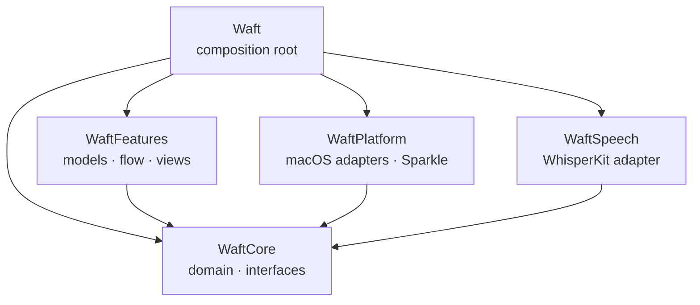

# Architecture

This page maps the code for contributors: the modules, the path a dictation takes through them, and the rules that keep them in place.

## Modules

| Module | Isolation | What lives there |
| --- | --- | --- |
| `WaftCore` | Nonisolated | Domain types, text and recognition rules, state machines, and every interface between modules |
| `WaftSpeech` | Nonisolated | `WhisperTranscriber`, its decoding rules, the model files, and the language-restricted tokenizer |
| `WaftPlatform` | Nonisolated | Adapters for audio, the keyboard, Accessibility, the pasteboard, storage, the AI APIs, license signatures, updates, and the system |
| `WaftFeatures` | Main actor | Observable models, the dictation flow, and every window and view |
| `Waft` | Main actor | The app, its delegate, and `AppDependencies.live()` |

## Code map

`WaftCore` has a folder per domain, `WaftPlatform` per area of the system, and `WaftFeatures` per feature, each named after what it holds; `WaftSpeech` is flat. New code goes into the folder it belongs to, or a new one beside it: a rule that needs no system access into `WaftCore`, code that touches macOS or the network into a `WaftPlatform` adapter behind a `WaftCore` interface, and state and views into `WaftFeatures`.

In `WaftFeatures`, a model or view that one screen uses lives with that screen. `App` holds `AppModel`, which builds every model from `AppDependencies` and wires them together, `Models` holds the state that several features share, `DesignSystem` what several views share, and `Settings` has a folder per pane.

`Tests` has a Swift Testing target for every module but `Waft`, laid out as [Tests](../CONTRIBUTING.md#tests) describes. `Packaging` holds the rest of the app bundle and the Homebrew cask template, and `scripts` the shell scripts that `make` runs.

## The dictation flow

1. `PermissionMonitor` polls the microphone and Accessibility status. A change moves onboarding on and makes `KeyMonitorController` start the `KeyEventMonitor`, which it also restarts when the monitor stops.
2. `DictationController` feeds the monitor's key events to `RecordingTriggers`, and `RecordingController` starts and stops the `AudioRecorder` and captures the focus target. Finished recordings go to the queue, and so does audio captured before a recording failed.
3. `DictationQueue` runs finished recordings one at a time: the `Transcriber` recognizes them, `TranscriptProcessor` applies the dictionary, snippets, and the mode, and the `TextInserter` pastes the result.
4. An AI mode runs the `TextRewriter` under the deadline of the chosen `CloudModel` or the local server, validates the answer with `RewriteValidator`, and on any `RewriteError` falls back to Light with a `RewriteFallback` that says why.
5. An edit by voice goes through `TranscriptProcessor.edit` instead, which sends the selection read at the key press and the spoken instruction to the `TextRewriter`. A failure pastes nothing.
6. The outcome becomes a `HUDMessage`. Recognized text is either pasted or copied, never dropped: a password field gets a copy instead of a paste. The text becomes a history entry unless it came from an edit or was kept out of a password field.

## Invariants

- Dependencies point toward `WaftCore`, which imports Foundation only and builds with strict memory safety. `WaftFeatures` never imports an adapter module; it sees adapters through the interfaces in `WaftCore`.
- Only `AppDependencies.live()` names concrete adapters. There are no singletons.
- Declarations shared between modules are `package`, never `public`. Imports follow the `InternalImportsByDefault` rule in [Platform](../CONTRIBUTING.md#platform).
- Rules that need no system access are value types in `WaftCore`.
- `WhisperTranscriber`, `AudioEngineRecorder`, and `MediaAudioReader` are actors, so recognition, audio, and media files stay off the main actor. The last two run on serial dispatch queues of their own, so their blocking calls never hold a thread of the cooperative pool.
- Audio, dictated text, and clipboard contents never reach the log or the disk, apart from the history the user keeps.
- A `UsageReport` holds counts, versions, and the names of settings, never text, audio, or the name of an app or a file, and nothing is counted or sent before the user agrees. A new field goes into [Usage data](privacy.md#usage-data) and `parseUsageReport` in `okoflow/waft-server` in the same release.
- User-facing strings use `String(localized:)` or `LocalizedStringKey`, even the names of domain values in `WaftCore`. Choosing a language in Waft writes `AppleTextDirection` next to `AppleLanguages`, so Arabic and Hebrew lay out right to left.

## Third-party packages

The package depends only on WhisperKit, from `argmax-oss-swift`, and Sparkle, pinned to exact versions in `Package.swift`. A pull request that adds a dependency says why the package needs it.

## Extending

To add a language:

1. Add a case to `Language` with its Whisper code.
2. Add its names in `Language+Names` and its writing systems in `Language+Typography`, where a period or question mark of its own also goes.
3. If it has marks that comparisons ignore, list them in `Language+Folding`.
4. Add its rows: hesitation sounds in `HesitationPattern`, stock phrases in `StockPhrase`, voice commands in `VoiceCommands`, and the example sentence in `WhisperPrompt`.
5. If it sounds like another language, add a group in `Language+SoundAlike`.

To add anything else:

- **A mode.** Add a case to `Mode` with its title, summary, and the raw value it is stored under, and list it in `Mode.builtIn`. An AI mode needs its instruction in `RewritePrompt`.
- **An AI provider.** Describe its API in `WaftPlatform/Rewrite/Providers` as a `RewriteAPI` with a model identifier for each `CloudModel`, add a `CloudProvider` case, a `PerProvider` property, the names of its models in `CloudProvider+Display`, and its key file in `SecretFileStore.apiKey(for:)`, wire it in `Rewriters.http`, and list its file in [What Waft keeps](privacy.md#what-waft-keeps).
- **An adapter.** Implement the interface in `WaftPlatform` and pass it in `AppDependencies.live()`.
