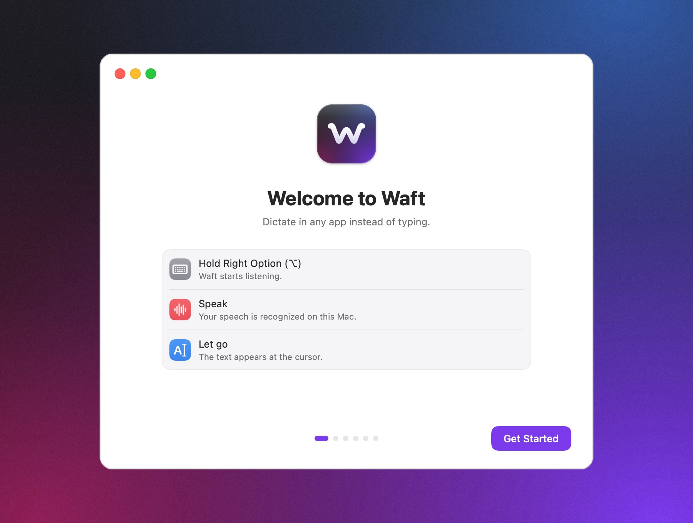

# Getting started

This page takes you from installing Waft to your first dictation.

## 1. Install

Waft runs on a Mac with Apple silicon and macOS 14 or later, with free disk space for the speech model; [The speech model](how-it-works.md#the-speech-model) lists the sizes. Install it with [Homebrew](https://brew.sh):

```sh
brew install --cask okoflow/tap/waft
```

Or download `Waft-X.Y.Z.dmg` from the [latest release](https://github.com/okoflow/waft/releases/latest), open it, and drag Waft to Applications. Waft is signed by the project but not yet notarized by Apple, so macOS blocks a copy from the disk image the first time it opens; a copy from Homebrew opens right away. Allow it once:

1. Open Waft, and click **Done** when macOS says it can't verify Waft.
2. In System Settings › Privacy & Security, click **Open Anyway** next to the message that Waft was blocked, and confirm with your password or Touch ID.
3. Click **Open Anyway** in the dialog that follows.

[Updates](usage.md#updates) then install from inside Waft. To build Waft yourself instead, follow [Development setup](../CONTRIBUTING.md#development-setup); building needs a newer macOS than running does.

## 2. Set up

On first launch, a short guide opens, and Waft downloads the speech model in the background.



1. **Allow microphone access**: click **Allow Access…**, then **Allow** in the macOS prompt.
2. **Allow Accessibility access**: click **Open System Settings** and turn on Waft, so it can notice the key and paste the text.
3. **Try it**: dictate into the box, as [First dictation](#3-first-dictation) describes.
4. **Help improve Waft**: click **Share** to send anonymous usage data or **Don't Share** to send nothing. [Usage data](privacy.md#usage-data) lists what a report holds.

If you close the guide early, **Finish Setup…** in the menu brings it back. If you set Waft up before it asked about usage data, the guide opens with that question alone each time Waft starts, until you answer.

## 3. First dictation

1. Click into a text field: a message, a document, a prompt for an AI.
2. Hold <kbd>right ⌥</kbd> and say "Hello, Waft". The HUD at the top of the screen shows that Waft is listening.
3. Let go. The text appears at the cursor.

If the first word goes missing, [Recognition is poor or picks the wrong language](troubleshooting.md#recognition-is-poor-or-picks-the-wrong-language) explains why.

## 4. Next steps

Read [The dictation key](usage.md#the-dictation-key) for hands-free dictation, [Modes](usage.md#modes) for AI cleanup, and [Languages](usage.md#languages) to add the languages you speak.
