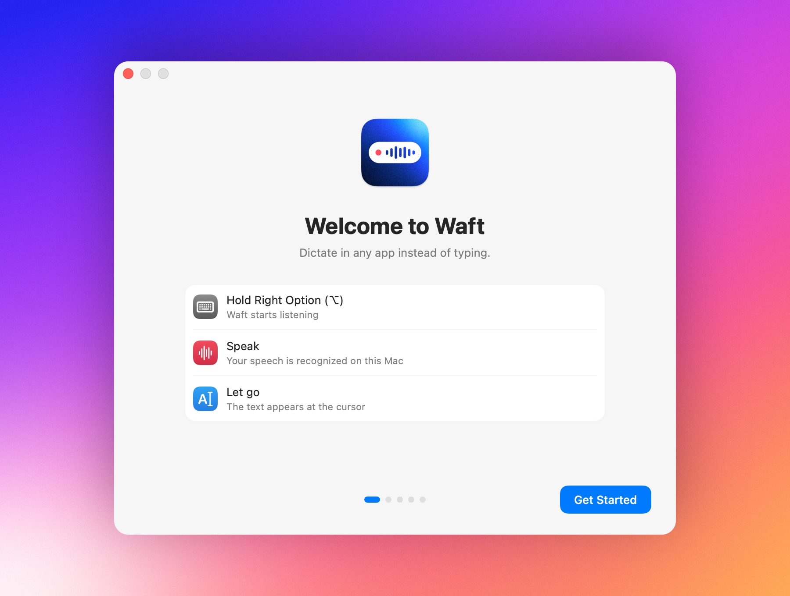

# Getting started

This page takes you from installing Waft to your first dictation.
[Usage](usage.md) covers everything after that, and
[Troubleshooting](troubleshooting.md) helps when something doesn't work.

## 1. Install

Waft runs on a Mac with Apple silicon and macOS 14 or later, with free disk
space for the speech model; [The speech model](how-it-works.md#the-speech-model)
lists the sizes. Until the first notarized release brings Homebrew and a disk
image, build Waft from source as
[Development setup](../CONTRIBUTING.md#development-setup) describes. Building
needs a newer macOS than running does.

## 2. Set up

On first launch, a short guide opens, and Waft downloads the speech model in
the background.

1. **Welcome to Waft** shows the gesture: hold the key, speak, let go.
2. **Allow microphone access**: click **Allow Access…**, then **Allow** in the
   macOS prompt.
3. **Allow Accessibility access**: click **Open System Settings** and turn on
   Waft, so it can notice the key and paste the text.
4. **Try it**: dictate into the box, as the next section describes.
5. **You're all set**: choose whether Waft opens at login, then click
   **Done**. If no AI model is set up, **Set Up…** next to **AI modes** opens
   Settings › AI Models.

The guide moves on by itself once a permission is allowed and skips one you
allowed before. If you close it early, **Finish Setup…** in the menu brings it
back.

## 3. First dictation

1. Click into a text field: a message, a document, a prompt for an AI. In the
   guide, click the box in **Try it**; while the speech model downloads, the
   line under it shows its progress.
2. Hold <kbd>right ⌥</kbd> and say "Hello, Waft". The HUD grows out of the
   notch, or drops from the top edge of a screen without one, to show that
   Waft is listening.
3. Let go. The text appears at the cursor.

If the first word goes missing,
[Recognition is poor or picks the wrong language](troubleshooting.md#recognition-is-poor-or-picks-the-wrong-language)
explains why.

## 4. Next steps

Read [The dictation key](usage.md#the-dictation-key) for hands-free dictation,
[Modes](usage.md#modes) for AI cleanup, and [Languages](usage.md#languages) to
add the languages you speak.
