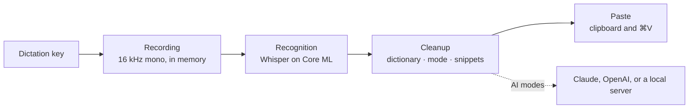

# How it works

This page explains what happens between pressing the dictation key and the
text appearing in your app. [Usage](usage.md) describes the settings, and
[Architecture](architecture.md) the code behind each stage.

## The key

A listen-only event tap watches the keyboard. It never swallows a key press,
so the dictation key keeps working everywhere else. Holding the key starts a
recording; releasing it after at least 0.3 seconds finishes it. Shorter
presses and another key pressed while holding are discarded; a recording that
reaches 5 minutes finishes on its own and is transcribed.

With **Tap**, letting go keeps the recording running and the next press
finishes it. With **Hold or double-tap**, a second short press within 0.4
seconds of the first does the same. A recording without the key held finishes
on the next press or after 5 minutes.

macOS can switch an event tap off when the system is busy, and a key-up can
get lost. Waft turns the tap back on, checks it every 5 seconds, and while you
record polls the key four times a second, so a lost key-up still ends the
recording.

## Recording

The microphone starts when the key goes down, from the device chosen in
Settings or the system default. Audio is converted to 16 kHz mono and kept in
memory; it is never written to disk. Recording continues for up to 0.15
seconds after you let go, to catch the end of the last word.

The HUD appears 0.3 seconds after the press, so a quick tap that does nothing
doesn't flash it. It never takes focus: the app you are typing in stays active.

Waft notes the focused app and text field when you press the key. The text
goes there later, and that app decides which mode applies.

## Recognition

Recordings without speech never reach the model: silence, key clicks, and
steady noise are recognized by how long the audio stays above its own noise
floor. Everything else goes to the speech model you chose, Whisper large-v3
turbo or large-v3, run on Core ML by
[WhisperKit](https://github.com/argmaxinc/argmax-oss-swift).

- **Language.** With one language pinned, Whisper decodes in that language.
  Otherwise it detects the language first, choosing only among the languages
  you enabled.
- **Prompt.** Whisper first reads a short example sentence in the spoken
  language, which nudges it toward punctuation and capitalization, followed
  by up to 200 characters of your dictionary terms.
- **Long recordings.** Audio over 30 seconds is split at pauses.
- **Made-up text.** Whisper sometimes invents text in silence. Waft drops
  segments with low confidence or heavy repetition, results made only of tags
  such as `[music]`, an echo of the prompt, and stock phrases such as "Thanks
  for watching" when they are the whole result. The HUD then says "Didn't
  catch that".

## Cleanup

The recognized text goes through four steps:

1. Dictionary terms replace their misheard spellings.
2. If the whole text is a snippet phrase, the snippet is used as it is and the
   steps below are skipped.
3. The mode runs: Raw keeps the text, Light applies its rules, and the AI
   modes ask the model you chose.
4. Dictionary terms are applied again, since a rewrite can undo them, and
   snippet phrases inside the text are expanded.

### Light

Light works word by word. It removes hesitation sounds, such as "um", "uh",
"ээ", "мм", "äh", "euh", "음", or "えーと", in their stretched and hyphenated
forms, together with the commas around them, but keeps one that follows a
number, as in "5 мм". It tidies the spaces around punctuation, following
French spacing before `!`, `?`, `;`, and `:`, capitalizes the first letter in
languages with letter case, with a dotted "İ" in Turkish and Azerbaijani, and
ends text that ends in a letter or digit with a period: "。" in Chinese and
Japanese, "।" in Hindi, "۔" in Urdu, and none in Thai. Filler words with
meaning, such as "like", "ну", or "그러니까", stay: telling them apart needs
Clean.

### The AI modes

Clean, Formal, Translate, and your modes send the text and a short instruction
for the mode to the model you chose: the Anthropic Messages API with
`claude-haiku-5-5` and thinking turned off, the OpenAI Responses API with
`gpt-6-luna`, reasoning turned off, and `store: false`, or the
`/chat/completions` endpoint of your local server. The transcript is marked as
text to edit, never instructions to follow, so dictating a question gives you
the question rather than an answer, and the model is told to reply with the
text only.

Your modes send your instructions between `<instructions>` tags after a short
preamble that asks for Clean's cleanup wherever they say nothing; with no
instructions they work like Clean.

The answer is checked before it is used. Waft rejects an answer that is
empty, cut off, or refused, one more than three times longer than what you
said (five times for a translation from Chinese, Japanese, or Korean), and one
written in another script than both the language you spoke and the transcript
itself, or, for Translate, than the target language. Your modes may answer in
any script and at up to ten times the length of what you said, or 600
characters for a short dictation, since their instructions can ask for a
translation or a longer text.

A cloud model gets 3 seconds and a local server 15. Without a key, offline,
on an error, a rate limit, a timeout, or a rejected answer, Waft uses Light
instead and the HUD adds a line that says why. The text is never lost.
[Troubleshooting](troubleshooting.md#the-ai-modes-use-light) lists each
reason and what to do about it.

### Editing by voice

An edit sends the selected text and your spoken instruction to the same
model. It gets 20 seconds in the cloud and 45 on a local server, since it can
rewrite a long selection. When it fails, nothing is pasted and the selection
stays as it was.

## Pasting

Waft pastes through the clipboard rather than typing key by key:

1. It waits for you to release the dictation key, for up to 10 seconds, since
   <kbd>⌘</kbd><kbd>V</kbd> with Option held would be a different shortcut.
2. It checks the focused field. A password field gets nothing, not even the
   clipboard. If focus moved to another app or field, or Accessibility isn't
   allowed, the text goes to the clipboard instead and the HUD says "press ⌘V
   to paste".
3. It saves the clipboard, puts the text on it, and presses
   <kbd>⌘</kbd><kbd>V</kbd> with the key that types "v" in your keyboard
   layout, so Dvorak and Colemak work too.
4. Once the app has read the text, it puts your previous clipboard back. If
   the app doesn't read it within 1.5 seconds, the text stays on the
   clipboard.

A space goes before the text when the character before the cursor isn't a
space, an opening bracket, or a quote, except in Chinese and Japanese text.

The clipboard is restored only when nothing else was copied in the meantime,
when it held no more than 5 MB, and when it didn't hold a password manager's
concealed item. Text, rich text, HTML, images, PDFs, files, and URLs survive
the paste. The pasted text is marked transient and concealed, so clipboard
managers that follow the [nspasteboard.org](http://nspasteboard.org)
conventions don't store it, and it stays off Universal Clipboard.

Texts are pasted one at a time, in the order you spoke them.

## The speech model

Settings › Dictation › **Speech model** offers two models from
[argmaxinc/whisperkit-coreml](https://huggingface.co/argmaxinc/whisperkit-coreml):

| Model | Files | Download | Speed |
| --- | --- | --- | --- |
| Fast | `openai_whisper-large-v3-v20240930_626MB`, Whisper large-v3 turbo | About 630 MB | The default |
| Accurate (Pro) | `openai_whisper-large-v3`, Whisper large-v3 | About 3.1 GB | About three times slower, with fewer mistakes outside English |

The model downloads once to `~/Library/Application Support/Waft/Models`.
Core ML compiles it for your chip the first time it loads, which takes up to a
minute, and keeps the compiled copy in `~/Library/Caches/com.okoflow.waft`,
about 130 MB. Later loads take about a second.

Choosing the other model downloads and loads it while the current one keeps
recognizing speech. Once the new model is ready, Waft deletes the files of the
one it replaced. Without Pro, Waft switches to Fast, downloads it if needed,
and then deletes Accurate: right away when you remove your license, and on the
next launch when the trial ends.

Changing the enabled languages reloads the model. A press while no model is
loaded records nothing; the HUD says what the model is doing instead.

## Limits

- The microphone takes a moment to start, so the first syllable can be lost
  if you speak the instant you press the key. Start speaking a beat after.
- Apps that expose little to Accessibility, such as some Electron apps, games,
  and remote desktops, still get the paste, but Waft can't see the text before
  the cursor there, so it adds no leading space.
- When an app holds secure keyboard input and Waft can't see the focused
  field, it treats the field as a password field and pastes nothing.
- <kbd>⌃</kbd><kbd>⌥</kbd><kbd>M</kbd> belongs to Waft while it runs. If
  another app holds it already, switch modes from the menu.
