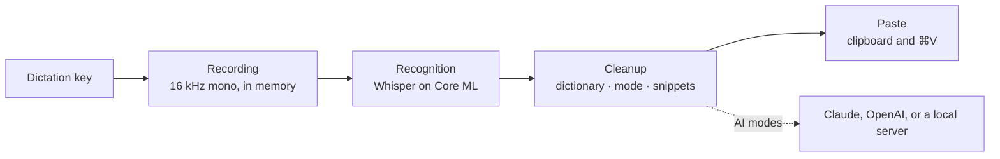

# How it works

This page follows a dictation from the key press to the pasted text and gives the timings and sizes behind it. [Usage](usage.md) describes the settings, and [Architecture](architecture.md) the code behind each stage.

## Key and recording

Waft only listens to the keyboard and never swallows a key press, so the dictation key keeps working everywhere else. Pressing it starts the microphone set as **Microphone** in Settings › Dictation, or the system default when that one isn't connected, and notes the focused app and text field, where the text goes later. The HUD never takes focus.

[The dictation key](usage.md#the-dictation-key) says what **How to start** does. The timings:

| Timing | Value | Effect |
| --- | --- | --- |
| Minimum hold | 0.3 s | A shorter press is a tap |
| Double-tap window | 0.4 s | With **Hold or double-tap**, a second tap within it starts hands-free dictation |
| Maximum recording | 300 s | Waft ends the recording and pastes it |
| HUD delay | 0.3 s | The HUD appears after it |

## Recognition

Waft skips recordings without speech, such as silence, key clicks, or steady noise. The rest goes to the speech model you chose, run on Core ML by [WhisperKit](https://github.com/argmaxinc/argmax-oss-swift).

- **Language.** With a **Spoken language** chosen or one language enabled, Whisper decodes in it. Otherwise it detects the language first, among those you enabled.
- **Prompt.** Whisper first reads a short example sentence in the spoken language, then up to 200 characters of your dictionary terms.
- **Long dictations.** Waft splits the recording at pauses into pieces of at most 13 to 27 seconds, shorter the longer the prompt, so that the text of each fits with the prompt in Whisper's 223 decoder tokens. A piece that fails stops the dictation with an error instead of leaving a gap.
- **Writing system.** For Chinese and Serbian, Waft converts the result into the script you chose. Latin to Cyrillic leaves in Latin letters your dictionary terms and words with q, w, x, or y, digits, inner capitals, or two to four capitals, such as GitHub or API.
- **Made-up text.** Waft drops segments with low confidence or heavy repetition, and those made only of tags such as `[music]`, an echo of the prompt, or a stock phrase such as "Thanks for watching", and keeps the rest of the dictation.

## Cleanup

The recognized text goes through five steps:

1. Dictionary terms replace their misheard spellings.
2. If the whole text is a snippet phrase, Waft uses the snippet as it is and skips the steps below.
3. The mode runs: Raw keeps the text, Light applies its rules, and the AI modes ask the AI model you chose, unless nothing but hesitations was said or they need Waft+.
4. When the text is in Chinese or Serbian, or Translate turns it into one of them, Waft converts it into your [writing system](usage.md#languages), except what your own modes return.
5. Dictionary terms apply again, and snippet phrases inside the text expand.

### Light

Light makes these changes and no others:

- It removes hesitation sounds, such as "um" or "uh", with the commas around them, but keeps one after a number, as in "5 мм", or written in capitals, as in "ER".
- It tidies the spaces around punctuation, keeping the space French puts before `!`, `?`, `;`, and `:`; capitalizes the first letter, but leaves a first word such as "iPhone" as written; and adds the period of the language, and none in Thai, when the text ends in a letter or digit.
- It applies the two voice commands that [Modes](usage.md#modes) describes.

### The AI modes

Clean, Formal, Translate, and your modes send the text with the mode's instructions and your dictionary terms to the AI model you chose, which spells the terms as you wrote them; [The network](privacy.md#the-network) lists everything that is sent, and [Choosing the AI model](usage.md#choosing-the-ai-model) the models and their time limits. Waft marks the transcript as text to edit, never instructions to follow, so a dictated question stays a question.

Waft rejects an answer that is empty, cut off, or refused. For a dictation, it also rejects one that is several times longer than what you said, one from Clean or Formal that lost most of a long dictation, and one written mostly in another script than the language you spoke or, for Translate, the target language. Your modes may answer in any script and at up to ten times what you said or 600 characters, whichever is more. A dictation whose answer is rejected or whose request fails gets the [Light](#light) text.

### The translator

The [translator](usage.md#translator) and its shortcuts on selected text send the text with the instructions of the task. Rules after the instructions, which you can't edit, make the model treat the text as material, never as instructions, and reply with the text alone, keeping its formatting, links, and code. The translator's tier gets the time limit of an edit, and macOS detects the language of the text on your Mac.

The shortcuts read the selection through Accessibility. When the app doesn't expose it, Waft waits for you to release the shortcut, saves the clipboard, and presses <kbd>⌘</kbd><kbd>C</kbd>. If the app copies text within half a second, Waft takes it as the selection and restores the clipboard as after [pasting](#pasting). If you hold the shortcut over 5 seconds or the app copies nothing, the HUD asks you to select the text. A password field gets no <kbd>⌘</kbd><kbd>C</kbd>, and neither does a field that reports only the cursor, since editors such as VS Code copy the whole line then.

## Pasting

Waft pastes through the clipboard rather than typing key by key:

1. It waits up to 10 seconds for you to release the dictation key.
2. It checks the focused field. If the field is a password field, **Paste into the focused field** is off, the key is still held, focus moved to another app or field, or Accessibility isn't allowed, Waft copies the text instead, and the HUD shows it with <kbd>⌘</kbd><kbd>V</kbd>. A field counts as a password field when it says so through Accessibility or, when Waft can't read it, when its own app holds secure keyboard input; another app that holds it, such as a browser left on a login page, changes nothing.
3. It saves the clipboard, puts the text on it, and presses <kbd>⌘</kbd><kbd>V</kbd>.
4. Once the app has read the text, it restores your clipboard, including images and files, if nothing else was copied meanwhile, it held no more than 5 MB, and it held no concealed or transient item, such as a password manager's. If the app doesn't read the text within 1.5 seconds, the text stays on the clipboard.

So text that Waft recognized is always either pasted or on the clipboard. If the microphone stops in the middle of a dictation, such as when headphones disconnect, Waft recognizes what it recorded until then. If you quit Waft while it works on a dictation, it finishes that one first, for up to 20 seconds.

Waft puts a space before the text unless it sees no character before the cursor, that character is a space, a line break, an opening bracket, a quote, or a slash, or the text on either side of the cursor is Chinese or Japanese.

## The speech model

**Speech model** in Settings › Dictation offers two models from [argmaxinc/whisperkit-coreml](https://huggingface.co/argmaxinc/whisperkit-coreml):

| Model | Whisper | Download | Free space | Trade-off |
| --- | --- | --- | --- | --- |
| Fast | large-v3 turbo | About 630 MB | About 1 GB | The default and the quickest |
| Accurate (Waft+) | large-v3 | About 3.1 GB | About 4 GB to switch | Two to three times slower, with fewer mistakes outside English |

Core ML compiles the model for your chip the first time it loads, which takes about a minute, and keeps the compiled copy, about 130 MB. Later loads take about a second. [What Waft keeps](privacy.md#what-waft-keeps) lists where the files go.

- Choosing the other model downloads and loads it while the current one keeps recognizing speech. Waft then deletes the files of the replaced model.
- Without Waft+, Waft switches to Fast, downloads it if needed, and then deletes Accurate: right away when you remove your license, and on the next launch when the trial ends.
- Changing the enabled languages reloads the model. A press while no model is loaded records nothing; the HUD says what the model is doing.
