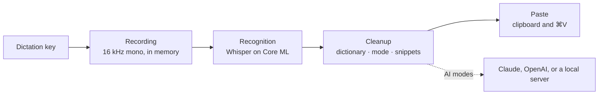

# How it works

This page follows a dictation from the key press to the pasted text.
[Usage](usage.md) describes the settings, and [Architecture](architecture.md)
the code behind each stage.

## The key

A listen-only event tap watches the keyboard. It never swallows a key press,
so the dictation key keeps working everywhere else. Pressing the key starts a
recording, and what releasing it does depends on **How to start**:

- **Hold**: a release after at least 0.3 seconds finishes the recording, and
  a shorter press is discarded.
- **Tap**: the recording keeps running, and the next press finishes it.
- **Hold or double-tap**: a long press works as with Hold, and a short press
  that starts within 0.4 seconds after a short one ends works as with Tap.

macOS can switch the tap off when the system is busy. Waft then discards the
recording in progress, turns the tap back on, and checks every 5 seconds that
it still runs. A key-up can also get lost, so while you hold the key, Waft
checks it four times a second and ends the recording about a second after you
let go.

## Recording

The microphone starts when the key goes down: the one set as **Microphone** in
Settings › Dictation, or the system default when that one isn't connected.
Waft converts the audio to 16 kHz mono and keeps it in memory, as
[Audio](privacy.md#audio) describes. After you let go, it waits up to 0.15
seconds for audio still on its way from the microphone, so the last word isn't
cut off.

The HUD appears 0.3 seconds after the press, so a quick tap that does nothing
doesn't flash it. It never takes focus: the app you are typing in stays
active. Waft notes the focused app and text field when you press the key, and
the text goes there later.

## Recognition

Waft skips recordings without speech, such as silence, key clicks, or steady
noise, by measuring how long the audio rises above its own noise floor.
Everything else goes to the speech model you chose, Whisper large-v3 turbo or
large-v3, run on Core ML by
[WhisperKit](https://github.com/argmaxinc/argmax-oss-swift).

- **Language.** With one language pinned or only one enabled, Whisper decodes
  in it. Otherwise it detects the language first, choosing only among the
  languages you enabled.
- **Prompt.** For most languages, Whisper first reads a short example sentence
  in the spoken language, which nudges it toward punctuation and
  capitalization, followed by up to 200 characters of your dictionary terms.
- **Writing system.** For Chinese and Serbian, the prompt is written in the
  script you chose, and Waft converts the result into it with the transforms
  macOS has for Simplified and Traditional characters and for Cyrillic to
  Latin. From Latin to Cyrillic it converts letter by letter, but leaves your
  dictionary terms and words with q, w, x, or y, digits, inner capitals, or
  two to four capitals, such as GitHub or API, in Latin letters.
- **Long recordings.** Audio over 30 seconds is split at pauses.
- **Made-up text.** Whisper sometimes invents text in silence. Waft drops
  segments with low confidence or heavy repetition, results made only of tags
  such as `[music]`, an echo of the prompt, and stock phrases such as "Thanks
  for watching" when they are the whole result.

When Waft skips a recording or drops the whole result, the HUD says "Didn't
catch that".

## Cleanup

The recognized text goes through five steps:

1. Dictionary terms replace their misheard spellings.
2. If the whole text is a snippet phrase, the snippet is used as it is and the
   steps below are skipped.
3. The mode runs: Raw keeps the text, Light applies its rules, and the AI
   modes ask the AI model you chose, unless nothing but hesitations was said.
4. For Chinese and Serbian, the result is converted into the writing system
   you chose, in case the AI model answered in the other one.
5. Dictionary terms are applied again, since a rewrite can undo them, and
   snippet phrases inside the text are expanded, so a snippet keeps the script
   you wrote it in.

### Light

Light makes these changes and no others:

- It removes hesitation sounds, such as "um", "uh", "ээ", "мм", "äh", "euh",
  "음", or "えーと", in their stretched and hyphenated forms, with the commas
  around them, but keeps one that follows a number, as in "5 мм".
- It tidies the spaces around punctuation, with French spacing before `!`,
  `?`, `;`, and `:`.
- It capitalizes the first letter in languages with letter case, with a
  dotted "İ" in Turkish and Azerbaijani.
- It adds a period when the text ends in a letter or digit: "。" in Chinese
  and Japanese, "।" in Hindi, "۔" in Urdu, and none in Thai.
- It applies the two voice commands that [Modes](usage.md#modes) describes.

### The AI modes

Clean, Formal, Translate, and your modes send the text, the spoken language,
and the mode's instructions to the AI model you chose: the Anthropic Messages
API, the OpenAI Responses API, or the `/chat/completions` endpoint of your
local server. Each model has a time limit for an answer, and a longer one for
an edit by voice, which can rewrite a long selection:

| Model | API identifier | Dictation | Edit |
| --- | --- | --- | --- |
| Haiku 5.5, GPT-6 Luna | `claude-haiku-5-5`, `gpt-6-luna` | 4 s | 20 s |
| Sonnet 5.5, GPT-6.1 Sol | `claude-sonnet-5-5`, `gpt-6.1-sol` | 6 s | 30 s |
| Opus 5.5, GPT-6 Astra | `claude-opus-5-5`, `gpt-6-astra` | 10 s | 45 s |
| A local server | The model you chose | 15 s | 45 s |

Cloud models think at low effort: they answer most dictations right away and
think briefly over a hard one, such as a misheard name. Waft leaves 4,096
output tokens for that thinking on top of the answer.

Waft marks the transcript as text to edit, never instructions to follow, and
tells the model to reply with the text alone, so dictating a question gives
you the question rather than an answer. Your modes send your instructions
between `<instructions>` tags after a short preamble that asks for Clean's
cleanup wherever they say nothing; with no instructions they work like Clean.

Waft rejects a dictation's answer that is:

- Empty, cut off, or refused.
- Longer than three times what you said plus 60 characters, or five times plus
  60 for a translation from Chinese, Japanese, or Korean.
- Written in another script than both the language you spoke and the
  transcript, or, for Translate, than the target language.

Your modes may answer in any script and at up to ten times the length of what
you said or 600 characters, whichever is more, since their instructions can
ask for a translation or a longer text. An edit's answer is rejected only when
it is empty, cut off, or refused.

When the model fails or its answer is rejected, a dictation gets the Light
text, as [Modes](usage.md#modes) describes.

## Pasting

Waft pastes through the clipboard rather than typing key by key:

1. It waits for you to release the key, for up to 10 seconds, since
   <kbd>⌘</kbd><kbd>V</kbd> with that key held would be a different shortcut.
2. It checks the focused field. A password field gets nothing, not even the
   clipboard. If focus moved to another app or field, or Accessibility isn't
   allowed, Waft copies the text instead and the HUD says "Copied: press ⌘V to
   paste".
3. It saves the clipboard, puts the text on it, and presses
   <kbd>⌘</kbd><kbd>V</kbd> with the key that types "v" in your keyboard
   layout, so Dvorak and Colemak work too.
4. Once the app has read the text, it puts your previous clipboard back. If
   the app doesn't read it within 1.5 seconds, the text stays on the
   clipboard.

Waft puts a space before the text unless the character before the cursor is a
space, a line break, an opening bracket, a quote, or a slash, or the text on
either side of the cursor is Chinese or Japanese.

Waft restores the clipboard only when nothing else was copied in the meantime,
it held no more than 5 MB, and it held no concealed or transient item, such as
a password manager's. Text, rich text, HTML, images, PDFs, files, and URLs
survive the paste.

## The speech model

**Speech model** in Settings › Dictation offers two models from
[argmaxinc/whisperkit-coreml](https://huggingface.co/argmaxinc/whisperkit-coreml):

| Model | Files | Download | Trade-off |
| --- | --- | --- | --- |
| Fast | Whisper large-v3 turbo, `openai_whisper-large-v3-v20240930_626MB` | About 630 MB | The default and the quickest |
| Accurate (Waft+) | Whisper large-v3, `openai_whisper-large-v3` | About 3.1 GB | Two to three times slower, with fewer mistakes outside English |

Core ML compiles the model for your chip the first time it loads, which takes
about a minute, and keeps the compiled copy, about 130 MB. Later loads take
about a second. [What Waft keeps](privacy.md#what-waft-keeps) lists where the
model and its compiled copy go.

Choosing the other model downloads and loads it while the current one keeps
recognizing speech. Once the new model is ready, Waft deletes the files of the
one it replaced. Without Waft+, Waft switches to Fast, downloads it if needed,
and then deletes Accurate: right away when you remove your license, and on the
next launch when the trial ends.

Changing the enabled languages reloads the model. A press while no model is
loaded records nothing; the HUD says what the model is doing instead.

## Limits

- The microphone takes a moment to start, so the first syllable can be lost
  if you speak the instant you press the key. Start speaking a beat after.
- Apps that expose little to Accessibility, such as some Electron apps, games,
  and remote desktops, still get the paste, but Waft can't see the text before
  the cursor there, so it adds no leading space.
- When an app holds secure keyboard input and Waft can't see the focused
  field, it treats the field as a password field and pastes nothing.
- <kbd>⌃</kbd><kbd>⌥</kbd><kbd>M</kbd> belongs to Waft while it runs. If
  another app holds it already, switch modes from the menu.
