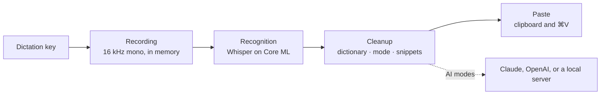

# How it works

This page follows a dictation from the key press to the pasted text and gives
the timings and sizes behind it. [Usage](usage.md) describes the settings, and
[Architecture](architecture.md) the code behind each stage.

## Key and recording

A listen-only event tap watches the keyboard and never swallows a key press,
so the dictation key keeps working everywhere else. Pressing it starts the
microphone set as **Microphone** in Settings › Dictation, or the system
default when that one isn't connected, and notes the focused app and text
field, where the text goes later. The HUD never takes focus.

[The dictation key](usage.md#the-dictation-key) says what **How to start**
does. The timings:

| Timing | Value | Effect |
| --- | --- | --- |
| Minimum hold | 0.3 s | A shorter press is a tap |
| Double-tap window | 0.4 s | With **Hold or double-tap**, a second tap within it starts hands-free dictation |
| Maximum recording | 300 s | Waft ends the recording and pastes it |
| HUD delay | 0.3 s | The HUD appears after it |
| Audio tail | 0.15 s | Waft waits up to this long after you let go for audio still arriving |
| Lost key-up | About 1 s | Waft checks the key four times a second and ends the recording if macOS never reported the release |
| Event tap check | 5 s | Waft starts the key listener again if it stopped. If macOS switches the tap off, Waft discards the recording in progress and turns the tap back on at once |

## Recognition

Waft skips recordings without speech, such as silence, key clicks, or steady
noise. The rest goes to the speech model you chose, run on Core ML by
[WhisperKit](https://github.com/argmaxinc/argmax-oss-swift).

- **Language.** With one language pinned or enabled, Whisper decodes in it.
  Otherwise it detects the language first, among those you enabled.
- **Prompt.** Whisper first reads a short example sentence in the spoken
  language, except in Japanese, Korean, and Thai, then up to 200 characters of
  your dictionary terms.
- **Writing system.** For Chinese and Serbian, Waft converts the result into
  the script you chose. Latin to Cyrillic goes letter by letter and leaves
  your dictionary terms, wherever the whole term appears, and words with q, w,
  x, or y, digits, inner capitals, or two to four capitals, such as GitHub or
  API, in Latin letters.
- **Made-up text.** Waft drops segments with low confidence or heavy
  repetition, results made only of tags such as `[music]`, an echo of the
  prompt, and stock phrases such as "Thanks for watching" when they are the
  whole result.

## Cleanup

The recognized text goes through five steps:

1. Dictionary terms replace their misheard spellings.
2. If the whole text is a snippet phrase, Waft uses the snippet as it is and
   skips the steps below.
3. The mode runs: Raw keeps the text, Light applies its rules, and the AI
   modes ask the AI model you chose, unless nothing but hesitations was said.
4. For Chinese and Serbian, Waft converts the result into your writing
   system, unless Translate put it into another language.
5. Dictionary terms apply again, and snippet phrases inside the text expand.

### Light

Light makes these changes and no others:

- It removes hesitation sounds, such as "um" or "uh", with the commas around
  them, but keeps one after a number, as in "5 мм", or written in capitals,
  as in "ER". An opening "¿", bracket, or quote next to a removed sound stays
  with the next word, and a sound inside its own marks, as in "¿eh?" or
  "(um)", goes with them.
- It tidies the spaces around punctuation, with French spacing before `!`,
  `?`, `;`, and `:`; capitalizes the first letter, with a dotted "İ" in
  Turkish and Azerbaijani, but leaves a first word such as "iPhone" as written;
  and adds a period when the text ends in a letter or digit: "。" in Chinese
  and Japanese, "।" in Hindi, "۔" in Urdu, and none in Thai.
- It applies the two voice commands that [Modes](usage.md#modes) describes.

### The AI modes

Clean, Formal, Translate, and your modes send the text, the spoken language,
and the mode's instructions to the AI model you chose.
[Choosing the AI model](usage.md#choosing-the-ai-model) lists the models and
their time limits. Waft marks the transcript as text to edit, never
instructions to follow, so a dictated question stays a question.

Waft rejects an answer that is empty, cut off, or refused. It also rejects a
dictation's answer that is:

- Longer than three times what you said plus 60 characters, or five times plus
  60 for a translation from Chinese, Japanese, or Korean.
- Written mostly in another script than both the language you spoke and the
  transcript, or, for Translate, than the target language. A Chinese,
  Japanese, or Korean character counts as three letters here, so a brand name
  in Latin letters doesn't outweigh the text around it.

Your modes may answer in any script and at up to ten times what you said or
600 characters, whichever is more. An edit has no other limit.

When the model fails or its answer is rejected, a dictation gets the Light
text. [The AI modes use Light](troubleshooting.md#the-ai-modes-use-light)
lists the reasons.

## Pasting

Waft pastes through the clipboard rather than typing key by key:

1. It waits up to 10 seconds for you to release the dictation key.
2. It checks the focused field. A password field gets nothing, not even the
   clipboard. If focus moved to another app or field, or Accessibility isn't
   allowed, Waft copies the text and the HUD says "Copied: press ⌘V to paste".
3. It saves the clipboard, puts the text on it, and presses
   <kbd>⌘</kbd><kbd>V</kbd> with the key that types "v" in your keyboard
   layout, so Dvorak and Colemak work too.
4. Once the app has read the text, it restores your clipboard, including
   images and files, if nothing else was copied meanwhile, it held no more
   than 5 MB, and it held no concealed or transient item, such as a password
   manager's. If the app doesn't read the text within 1.5 seconds, the text
   stays on the clipboard.

Waft trims the spaces at both ends of the text but keeps a line break that
"new line" or "new paragraph" put there. It puts a space before the text
unless the character before the cursor is a space, a line break, an opening
bracket, a quote, or a slash, the text starts with a line break, or the text
on either side of the cursor is Chinese or Japanese.

## The speech model

**Speech model** in Settings › Dictation offers two models from
[argmaxinc/whisperkit-coreml](https://huggingface.co/argmaxinc/whisperkit-coreml):

| Model | Whisper | Download | Free space | Trade-off |
| --- | --- | --- | --- | --- |
| Fast | large-v3 turbo | About 630 MB | About 1 GB | The default and the quickest |
| Accurate (Waft+) | large-v3 | About 3.1 GB | About 4 GB to switch | Two to three times slower, with fewer mistakes outside English |

Core ML compiles the model for your chip the first time it loads, which takes
about a minute, and keeps the compiled copy, about 130 MB. Later loads take
about a second. [What Waft keeps](privacy.md#what-waft-keeps) lists where the
files go.

- Choosing the other model downloads and loads it while the current one keeps
  recognizing speech. Waft then deletes the files of the replaced model.
- Without Waft+, Waft switches to Fast, downloads it if needed, and then
  deletes Accurate: right away when you remove your license, and on the next
  launch when the trial ends.
- Changing the enabled languages reloads the model. A press while no model is
  loaded records nothing; the HUD says what the model is doing.
