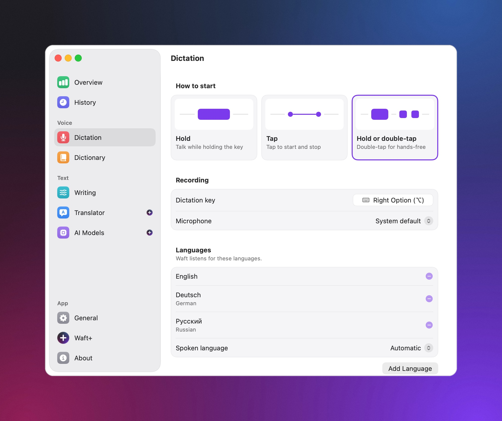
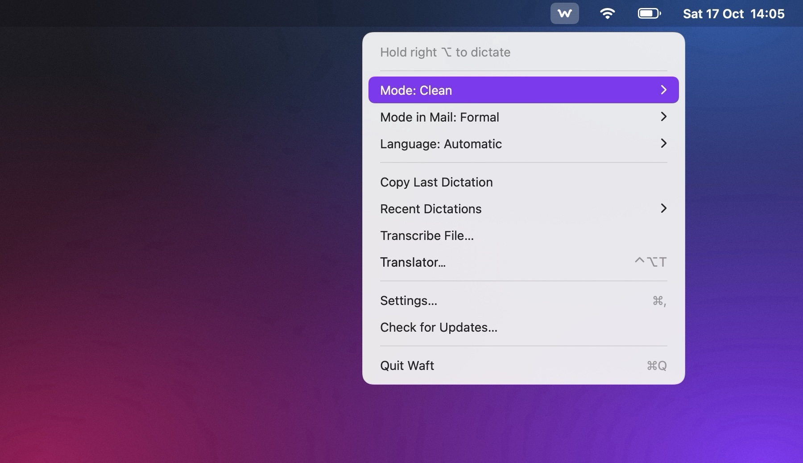

# Usage

This page covers dictating, the modes, and every other feature and setting of Waft. [Getting started](getting-started.md) covers the first launch, and [How it works](how-it-works.md) what happens behind the scenes.

## Dictating

Hold the dictation key, speak, and let go. The HUD at the top of the screen shows the time and a level meter while you speak, then the step Waft is on. After pasting, it shows "Pasted" for a few seconds; point at it to see the text, and click to copy it again.

- Cancel a recording with <kbd>Esc</kbd>, which still reaches the app in front, or by pressing another key while you hold the dictation key.
- A recording ends after 5 minutes, and Waft pastes what you said.
- You can dictate again while Waft recognizes the previous text; the texts arrive in order.
- With **Paste into the focused field** off in Settings › Writing, Waft only copies the text.
- **Play sounds** in Settings › Dictation, on by default, plays a chime when recording starts and another when it stops.
- **Lower other sounds while recording** there, on by default, turns the Mac's volume down to a quarter while you record.

### The dictation key

The dictation key is <kbd>right ⌥</kbd>. To change it, click **Dictation key** in Settings › Dictation and press Option, Command, Shift, or Control on either side, Fn (🌐), or a function key. Keys that type text and the editing key don't work. **How to start** in the same pane sets what the key does:

| How to start | What the key does |
| --- | --- |
| Hold | Waft listens while you hold the key; a quick tap does nothing |
| Tap | Tap to start and tap again to finish |
| Hold or double-tap (default) | Hold the key, or tap it twice to dictate hands-free and once more to finish |

## Languages



Waft understands 45 languages. Add the ones you speak with **Add Language** in Settings › Dictation, and Waft detects which one you speak each time; fewer languages detect faster and more accurately. To skip detection, choose a **Spoken language** there or in the **Language** menu.

- Languages that sound alike get mixed up when enabled together, such as Russian and Ukrainian, Danish and Norwegian, Indonesian and Malay, or Serbian, Croatian, and Bosnian. Choose the one you speak as the **Spoken language**.
- Chinese and Serbian have a **Writing system** in Settings › Dictation: Simplified or Traditional characters, and Latin or Cyrillic letters. Waft converts what you dictate, transcribe, or translate into that language into it, but not what your own modes, an edit by voice, or a fix of selected text return.

## Modes

Light is the default. Choose a mode under **Mode** in the menu or in Settings › Writing, or press <kbd>⌃</kbd><kbd>⌥</kbd><kbd>M</kbd> for the next one.

| Mode | What it does | AI model |
| --- | --- | --- |
| Raw | Pastes what Whisper heard | No |
| Light | Removes hesitations such as "um", tidies the spacing, capitalizes, and adds a period. In 19 languages, "new line" or "new paragraph", said as a phrase of its own with a short pause around it, starts one | No |
| Clean | Also removes filler words and false starts, keeps your final version in your language, and fixes grammar and punctuation. Spoken punctuation such as "comma", dates, times, and amounts become marks and digits, and an explicit enumeration, such as "first…, second…", goes on numbered lines | Yes |
| Formal | Clean in a polite business tone, keeping how you address the reader (*du* or *Sie*) | Yes |
| Translate | Translates into **Translate into** in Settings › Writing, English by default. **Two-way with** adds a second language, so with English and Russian each comes out in the other | Yes |
| Your modes | Follow the instructions you wrote | Yes |

When the AI model can't be used, Waft pastes the Light text and the HUD shows "Without AI". [The AI modes use Light](troubleshooting.md#the-ai-modes-use-light) lists the reasons.

### Choosing the AI model

Choose the **Provider** in Settings › AI Models, Claude by default.

- **Claude** and **OpenAI** need an API key: paste it under **API key** and click **Save**. Create the Claude key inside a workspace in the [Anthropic Console](https://console.anthropic.com/settings/keys) and the OpenAI key in the [OpenAI dashboard](https://platform.openai.com/settings/organization/api-keys).
- **Local server** calls Ollama, LM Studio, llama.cpp, MLX, Jan, or any server with an OpenAI-compatible `/v1/chat/completions` endpoint. **Detect** finds a running one.

**Model** offers a local server's models or, for Claude and OpenAI, three tiers. A model that misses its time limit makes a dictation fall back to Light and leaves an edit's selection alone. A local server gets 15 seconds for a dictation and 45 for an edit.

| Tier | Claude | OpenAI | Dictation limit | Edit limit |
| --- | --- | --- | --- | --- |
| Quickest and cheapest | Haiku 5.5 | GPT-6 Luna | 4 s | 20 s |
| Fewer mistakes, still quick (default) | Sonnet 5.5 | GPT-6.1 Sol | 6 s | 30 s |
| Fewest mistakes, slower and pricier | Opus 5.5 | GPT-6 Astra | 10 s | 45 s |

### Custom and per-app modes

- The arrow next to Clean, Formal, or Translate in Settings › Writing opens its **Instructions**, which you can rewrite. **Reset to Default…** restores them.
- **New Mode** under **Your modes** adds a mode from a name and instructions, such as "reply as a short, friendly email and sign with my name". Where they say nothing, Waft removes hesitations, fixes grammar and punctuation, and keeps your language.
- **Delete Mode…** removes one. Apps that used it switch to the default mode, or to Light if it was the default.
- **Run** in **Try it** on a mode's page runs the sentence under **You say** through your AI model, without the dictionary.
- Give an app its own mode, such as Formal in Mail, with **Mode in *app*** in the menu while the app is in front, or **Add App…** in Settings › Writing › Apps.

## Editing by voice

Set the **Editing key** in Settings › Dictation; there's none by default, and it always works by holding. Select text, hold the key, say what to change, such as "make it shorter" or "translate into German", and let go. The AI model rewrites the selection, and Waft pastes the result over it.

Waft reads the selection through Accessibility, so an edit doesn't work in an app that doesn't expose it there, such as Chrome or an Electron app. A failed edit changes nothing; [The text isn't pasted](troubleshooting.md#the-text-isnt-pasted) lists what the HUD says then.

## Translator

**Translator…** in the menu, or <kbd>⌃</kbd><kbd>⌥</kbd><kbd>T</kbd> in any app, opens a floating panel over the app you're in, with your text on the left and its translation on the right. Type or paste up to 5,000 characters, or dictate; the AI model translates when you stop typing.

- The left half detects the language unless you choose one. The right half translates into **Translate into**, English by default, and text already in that language into **Two-way with**, as Translate does. Change **Translate into** in the panel, and both in Settings › Translator.
- When the text is in one of the two languages on the right, Waft goes by that instead of the language you chose on the left and shows "detected" next to it.
- A click on the translation copies all of it; select a part to copy only that. The arrows between the halves, or <kbd>⌘</kbd><kbd>⇧</kbd><kbd>S</kbd>, swap the texts and the languages.
- <kbd>Esc</kbd>, a click outside the panel, or switching apps or desktops closes it, and the text is there the next time you open it.
- The arrow next to **Translation** or **Fixing** in Settings › Translator opens its **Instructions**, which you can rewrite and try as for a mode.
- **Model** in Settings › Translator sets the translator's own [tier](#choosing-the-ai-model). A local server translates with its own model.

### Selected text

Two [shortcuts](#shortcuts) work on text selected in any app:

- **Translate selected text** replaces the selection with its translation into the translator's languages.
- **Fix selected text** corrects its spelling, grammar, and punctuation.

Waft reads the selection through Accessibility, or copies it with <kbd>⌘</kbd><kbd>C</kbd> in apps that don't expose it there, such as Chrome or an Electron app; [The translator](how-it-works.md#the-translator) has the details. If focus moved while the AI model worked, Waft copies the result instead. A failure changes nothing; [The text isn't pasted](troubleshooting.md#the-text-isnt-pasted) lists what the HUD says then.

## Transcribing files

**Transcribe File…** in the menu opens a window for recordings and videos. Drop a file on it or click **Choose File…**. Whisper transcribes it on your Mac in the language it detects or the one you choose under **Language**, with no mode or dictionary. Copy the text, or click **Save Text…** or **Save Subtitles…** for SRT subtitles. Dictation keeps working meanwhile.

## Dictionary and snippets

Settings › Dictionary holds two lists:

- **Terms** are names and words that come out wrong. Waft gives them to Whisper and to the AI modes as a hint, then replaces the spellings Whisper still writes, which you list under **Heard as**, separated by commas. Replacements match whole words in any letter case and work in every mode.
- **Snippets** turn a phrase into text. Say the phrase on its own, and Waft pastes the text as written, without an AI model. The phrase inside a longer dictation is replaced too.

**Open in Editor** opens both lists as `dictionary.json`. Edits apply from the next dictation.

```json
{
  "terms": [
    { "term": "Kubernetes", "spoken": ["kubernetis", "kuber"] },
    { "term": "WhisperKit" }
  ],
  "snippets": [
    { "trigger": "my email", "text": "name@example.com" }
  ]
}
```

## History and statistics

- Settings › Overview shows your statistics for the last 7 days and of all time, with the time saved counted against typing at 40 words a minute. **Reset Statistics…** sets the counts to zero.
- Settings › History lists your dictations with the time, mode, and app. **Copy** next to one copies it, and **Copy Original Transcript** in its Control-click menu copies what Whisper heard before a mode rewrote it. They stay for a month and up to 1,000 unless you change **Keep dictations for** or **Keep at most**. To stop saving, turn off **Keep history**; **Clear History…** deletes them all.

## Shortcuts

Four shortcuts work in any app. To change one, click it and press a key with Command, Control, or Option, or a function key, that no other Waft shortcut or key uses. The minus button next to it turns it off, and the arrow button brings the default back.

| Shortcut | Default | Where |
| --- | --- | --- |
| **Switch to the next mode** | <kbd>⌃</kbd><kbd>⌥</kbd><kbd>M</kbd> | Settings › Writing |
| **Open the translator** | <kbd>⌃</kbd><kbd>⌥</kbd><kbd>T</kbd> | Settings › Translator |
| **Translate selected text** | <kbd>⌃</kbd><kbd>⌥</kbd><kbd>⇧</kbd><kbd>T</kbd> | Settings › Translator |
| **Fix selected text** | <kbd>⌃</kbd><kbd>⌥</kbd><kbd>F</kbd> | Settings › Translator |

## The menu



Waft lives in the menu bar and shows in the Dock only while Settings, the setup guide, the file transcription window, or an update prompt is open. The first line of the menu says what Waft is doing, such as which key to hold or tap, "Listening…", or "Setup needed". **Copy Last Dictation** copies the latest text, pasted or not, within 10 minutes of the dictation, and **Recent Dictations** one of your last five.

To hide the icon, turn off **Show in menu bar** in Settings › General. Dictation and the shortcuts keep working, and opening Waft again brings up Settings.

## General settings

- **Open at login** in Settings › General starts Waft when you log in.
- **Share anonymous usage data** sends daily counts of the features you use and nothing you say or type. **What is sent** under it opens [Usage data](privacy.md#usage-data), which lists every field.
- **App language** switches Waft's interface between 23 languages, or **Same as macOS**, once you click **Relaunch** next to it.

## Updates

Waft checks for updates once a day and asks before installing one. To check only with **Check Now** in Settings › General or **Check for Updates…** in the menu, turn off **Check for updates automatically** there. Waft installs only an update signed with the project's key.

## Waft+

Dictation, the Raw and Light modes, the dictionary, and history are free. Waft+ adds Clean, Formal, Translate, rewritten instructions, your modes, editing by voice, the translator, file transcription, and the Accurate speech model for a single payment of $13.99. **Speech model** in Settings › Dictation switches between Fast and Accurate; [The speech model](how-it-works.md#the-speech-model) compares them.

While Waft is in beta, every Waft+ feature is free and needs no license. Once Waft+ goes on sale, a trial unlocks it for 3 calendar days, starting on the day you first open a version that sells it. After the trial, until you add a license in Settings › Waft+, an AI mode falls back to Light, the editing key, the translator, and file transcription say they need Waft+, and Waft recognizes speech with Fast.

The license key arrives with your receipt: paste it into **License key** and click **Activate**, or open the activation link in the email. Waft checks the key on your Mac, without contacting a server. **Remove License…** takes it off this Mac.
