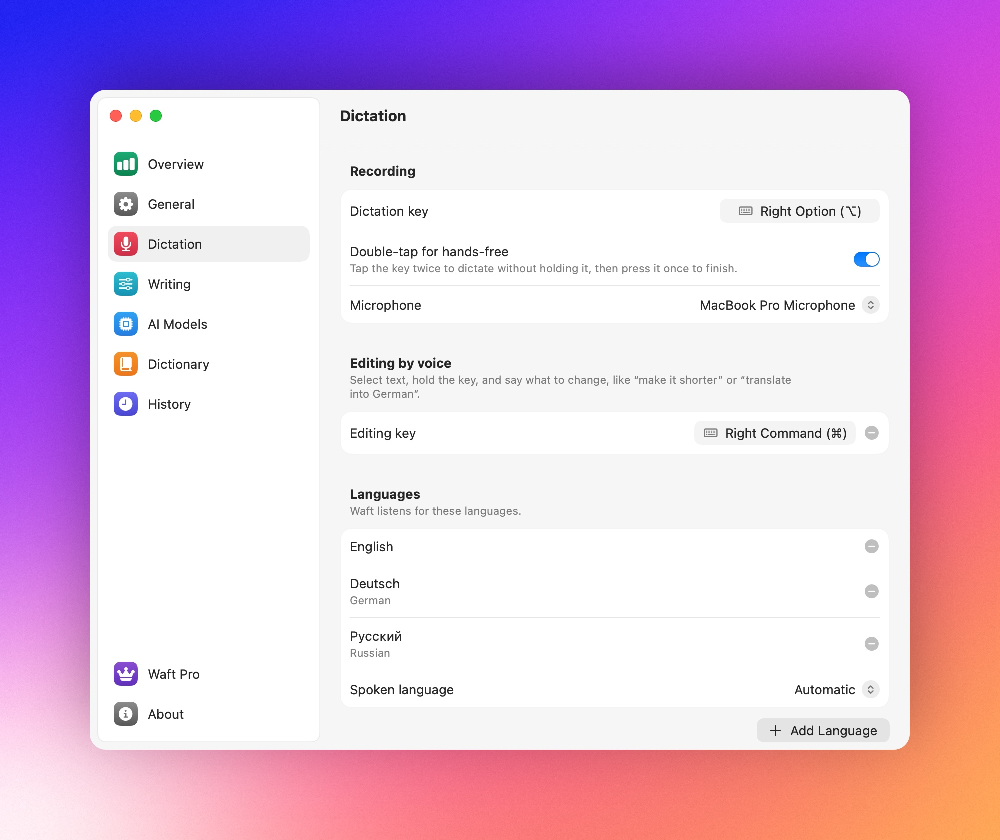
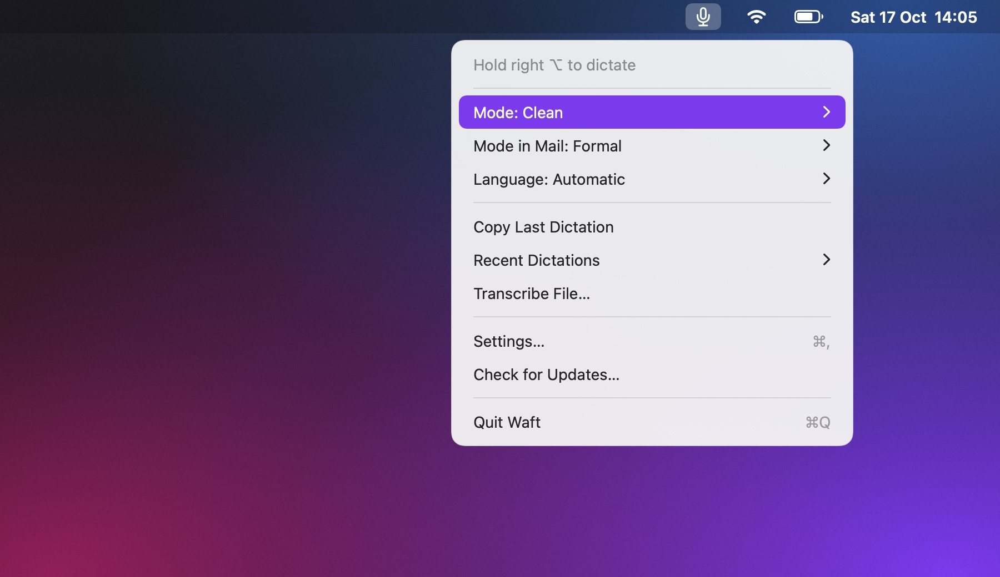

# Usage

This page covers dictating, the modes, and every other feature and setting of
Waft. [Getting started](getting-started.md) covers the first launch, and
[How it works](how-it-works.md) what happens behind the scenes.

## Dictating

Hold the dictation key, speak, and let go. The HUD grows out of the notch, or
drops from the top edge of a screen without one. It shows the time and a level
meter while you speak, with a lock instead of the microphone when you dictate
hands-free, and a dotted orb while Waft transcribes. While an AI mode cleans the
text up, it shows the mode's name and what Whisper heard. After pasting, it
shows the text, up to three lines; click it to copy the whole text again.

- Cancel a recording with <kbd>Esc</kbd>, which still reaches the app in front,
  or by pressing another key while you hold the dictation key. Nothing is
  pasted.
- A recording ends after 5 minutes, and Waft pastes what you said.
- You can dictate again while Waft recognizes the previous text; the texts
  arrive in order.
- With **Paste into the focused field** off in Settings › Writing, Waft only
  copies the text.

### The dictation key

The dictation key is <kbd>right ⌥</kbd>. To change it, click **Dictation key**
in Settings › Dictation and press Option, Command, Shift, or Control on either
side, Fn (🌐), or a function key. Keys that type text and the editing key don't
work. **How to start** in the same pane sets what the key does:

| How to start | What the key does |
| --- | --- |
| Hold | Waft listens while you hold the key; a quick tap does nothing |
| Tap | Tap to start and tap again to finish |
| Hold or double-tap (default) | Hold the key, or tap it twice to start and once more to finish |

## Languages



Waft understands 45 languages. Add the ones you speak with **Add Language** in
Settings › Dictation, and Waft detects which you speak each time; fewer
languages detect faster and more accurately. To skip detection, choose a
**Spoken language** there or in the **Language** menu.

- Languages that sound alike get mixed up when enabled together, such as
  Russian and Ukrainian, Danish and Norwegian, Indonesian and Malay, or
  Serbian, Croatian, and Bosnian. Choose the one you speak as the **Spoken
  language**.
- Chinese and Serbian have a **Writing system** in Settings › Dictation:
  Simplified or Traditional characters, and Latin or Cyrillic letters. Waft
  converts what you dictate or transcribe in that language into it, including
  what Translate translates into it; what your own modes return, a result in
  another language, and an edit by voice keep the script the AI model wrote.

## Modes

Light is the default. Choose a mode under **Mode** in the menu or in Settings ›
Writing, or press <kbd>⌃</kbd><kbd>⌥</kbd><kbd>M</kbd> for the next one.

| Mode | What it does | AI model |
| --- | --- | --- |
| Raw | Pastes what Whisper heard | No |
| Light | Removes hesitations such as "um", tidies the spacing, capitalizes, and adds a period. In 19 languages, "new line" or "new paragraph", said as a phrase of its own with a short pause around it, starts one | No |
| Clean | Also removes filler words and false starts, keeps your final version in your language, and fixes grammar and punctuation. Spoken punctuation such as "comma", dates, times, and amounts become marks and digits, and enumerations go on numbered lines | Yes |
| Formal | Clean in a polite business tone, keeping how you address the reader (*du* or *Sie*) | Yes |
| Translate | Translates into **Translate into** in Settings › Writing, English by default. **Two-way with** adds a second language, so with English and Russian each comes out in the other | Yes |
| Your modes | Follow the instructions you wrote | Yes |

When the AI model can't be used, Waft pastes the Light text and the HUD says
why. [The AI modes use Light](troubleshooting.md#the-ai-modes-use-light) lists
the reasons.

### Choosing the AI model

Choose the **Provider** in Settings › AI Models, Claude by default.

- **Claude** and **OpenAI** need an API key: paste it under **API key** and
  click **Save**, and **Remove…** deletes it after you confirm. Create the
  Claude key inside a workspace in the [Anthropic Console](https://console.anthropic.com/settings/keys)
  and the OpenAI key in the
  [OpenAI dashboard](https://platform.openai.com/settings/organization/api-keys).
- **Local server** calls Ollama, LM Studio, llama.cpp, MLX, Jan, or any server
  with an OpenAI-compatible `/v1/chat/completions` endpoint. **Detect** finds a
  running one. The text goes only to that server.

**Model** offers a local server's models or, for Claude and OpenAI, three
tiers. A model that misses its time limit makes a dictation fall back to Light
and leaves an edit's selection alone. A local server gets 15 seconds for a
dictation and 45 for an edit.

| Tier | Claude | OpenAI | Dictation limit | Edit limit |
| --- | --- | --- | --- | --- |
| Quickest and cheapest | Haiku 5.5 | GPT-6 Luna | 4 s | 20 s |
| Fewer mistakes, still quick (default) | Sonnet 5.5 | GPT-6.1 Sol | 6 s | 30 s |
| Fewest mistakes, slower and pricier | Opus 5.5 | GPT-6 Astra | 10 s | 45 s |

### Custom and per-app modes

- The arrow next to Clean, Formal, or Translate in Settings › Writing opens its
  **Instructions**, which you can rewrite. **Reset to Default…** restores them
  after you confirm.
- **New Mode** under **Your modes** adds a mode from a name and instructions,
  such as "reply as a short, friendly email and sign with my name". Where they
  say nothing, Waft removes hesitations, fixes grammar and punctuation, and
  keeps your language.
- **Delete Mode…** removes one. Apps that used it switch to the default mode,
  or to Light if it was the default.
- **Run** in **Try it** on a mode's page runs the sentence under **You say**
  through your AI model, without the dictionary.
- Give an app its own mode, such as Formal in Mail, with **Mode in *app*** in
  the menu while the app is in front, or **Add App…** in Settings › Writing ›
  Apps. Waft uses the mode of the app that was in front when you pressed the
  key.

## Editing by voice

Set the **Editing key** in Settings › Dictation; there's none by default, and
it always works by holding. Select text in any app, hold the key, say what to
change, such as "make it shorter" or "translate into German", and let go. The
AI model rewrites the selection and Waft pastes the result over it. A failed
edit changes nothing;
[The text isn't pasted](troubleshooting.md#the-text-isnt-pasted) lists what the
HUD says then.

## Transcribing files

**Transcribe File…** in the menu opens a window for recordings and videos.
Drop a file on it or click **Choose File…**. Whisper transcribes it on your Mac
in the language it detects or the one you choose under **Language**, with no
mode or dictionary. Copy the text, or click **Save Text…** or
**Save Subtitles…** for SRT subtitles. Dictation keeps working meanwhile.

## Dictionary and snippets

Settings › Dictionary holds two lists:

- **Terms** are names and words that come out wrong. Waft gives them to Whisper
  as a hint, then replaces the spellings Whisper still writes, which you list
  under **Heard as**, separated by commas. Replacements match whole words in
  any letter case and work in every mode.
- **Snippets** turn a phrase into text. Say the phrase on its own, and Waft
  pastes the text as written, without an AI model. The phrase inside a longer
  dictation is replaced too.

**Open in Editor** opens both lists as `dictionary.json`. Edits apply from the
next dictation.

```json
{
  "terms": [
    { "term": "Kubernetes", "spoken": ["kubernetis", "kuber"] },
    { "term": "WhisperKit" }
  ],
  "snippets": [
    { "trigger": "my email", "text": "name@example.com" }
  ]
}
```

## History and statistics

- Settings › Overview shows your words, the time saved over typing at 40 words
  a minute, and your speaking speed for the last 7 days, and your words,
  dictations, and days in a row of all time. **Reset Statistics…** sets the
  counts to zero.
- Settings › History lists your dictations with the time, mode, and app.
  **Copy** next to one copies it, and **Search** finds one. They stay for a
  month and up to 1,000 unless you change **Keep dictations for** or
  **Keep at most**. Turn off **Keep history** to stop saving;
  **Clear History…** deletes them all.

## The menu



Waft lives in the menu bar, as the Waft W mark, and shows in the Dock only
while one of its windows is open.

| Item | What it does |
| --- | --- |
| The first line | Says what Waft is doing, such as which key to hold or tap, "Listening…", or "Setup needed" |
| Finish Setup…, Retry Speech Model, Install Update… | Appear only when needed: setup is unfinished or a permission is missing, the speech model failed, or an update is waiting |
| Copy Last Dictation, Recent Dictations | Copy the latest text, pasted or not, within 10 minutes of the dictation, or one of your last five dictations; **Show History** opens the full list |
| Unlock Waft+… | Appears while you have no license once Waft+ is on sale |

To hide the icon, turn off **Show in menu bar** in Settings › General.
Dictation and <kbd>⌃</kbd><kbd>⌥</kbd><kbd>M</kbd> keep working, and opening
Waft again brings up Settings.

## General settings

- **App language** in Settings › General switches Waft's interface between 23
  languages, or **Same as macOS**. Arabic and Hebrew lay it out from right to
  left.
- **Lower other sounds while recording**, on by default, turns the Mac's volume
  down to a quarter once recording starts and restores it afterward, unless you
  changed it meanwhile.

## Updates

Waft checks for updates once a day and asks before installing one. Turn off
**Check for updates automatically** in Settings › General to check only with
**Check Now** there or **Check for Updates…** in the menu. Waft installs only
an update signed with the project's key. A debug build, such as one from
`make run`, doesn't update itself;
[Development setup](../CONTRIBUTING.md#development-setup) describes how to
build again.

## Waft+

Dictation, the Raw and Light modes, the dictionary, and history are free.
Waft+ adds Clean, Formal, Translate, rewritten instructions, your modes,
editing by voice, file transcription, and the Accurate speech model for a
single payment of $13.99. **Speech model** in Settings › Dictation switches
between Fast and Accurate;
[The speech model](how-it-works.md#the-speech-model) compares them.

While Waft is in beta, every Waft+ feature is free and needs no license. Once
Waft+ goes on sale, a trial unlocks it for 3 calendar days, starting on the day
you first open a version that sells it. After the trial, until you add a
license in Settings › Waft+:

| Feature | Without a license |
| --- | --- |
| The AI modes | Fall back to Light, and the HUD says so; <kbd>⌃</kbd><kbd>⌥</kbd><kbd>M</kbd> switches only between Raw and Light |
| Editing by voice | The editing key records nothing, and the HUD says it needs Waft+ |
| The speech model | Waft recognizes speech with Fast |
| The menu | Marks the AI modes and file transcription "(Waft+)" |

The license key arrives with your receipt: paste it into **License key** and
click **Activate**, or open the activation link in the email. Waft checks the
key on your Mac, without contacting a server. **Remove License…** takes it off
this Mac.
